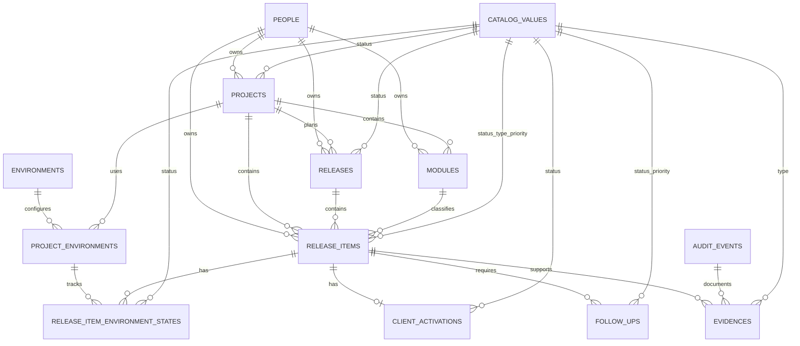

# Database Design — Project and Release Control Local MVP

**Tecnología:** MySQL 8.x · Laravel  
**Alcance:** MVP local, inicialmente de un solo usuario  
**Proyecto piloto:** Reports  
**Ambientes iniciales:** MOJA, TATU, SITA, PROD

## 1. Recomendación principal

Se recomienda una base de datos relacional normalizada, con una separación clara entre:

1. El inventario de proyectos, módulos, releases e ítems.
2. El estado actual de cada ítem en cada ambiente.
3. La activación para clientes, independiente del despliegue en PROD.
4. Los seguimientos, responsables y fechas objetivo.
5. La evidencia y el historial inmutable de cambios.
6. Los catálogos configurables y parámetros operativos.

Laravel migrations debe ser la fuente de verdad de la estructura. MySQL almacenará los datos, pero los cambios del esquema se crearán, revisarán y versionarán como migraciones dentro del repositorio.

## 2. Decisiones de diseño

### 2.1 Identificadores

- Usar `ULID` de 26 caracteres para las entidades operativas.
- Usar `BIGINT UNSIGNED` autoincremental para catálogos pequeños.
- Los ULID facilitan una futura migración desde la instalación local a un entorno compartido sin depender de rangos autoincrementales.

### 2.2 Fechas

- Guardar todos los instantes técnicos en UTC mediante `DATETIME(6)`.
- Usar `DATE` para fechas de negocio sin hora, como `target_date` y `due_date`.
- Convertir a la zona horaria configurada únicamente en la aplicación.

### 2.3 Eliminación lógica

- Usar `deleted_at` en proyectos, módulos, releases, ítems, personas y seguimientos.
- No aplicar eliminación lógica a `audit_events`; estos registros son append-only.
- Desactivar ambientes y valores de catálogo mediante `is_active`, en lugar de eliminarlos.

### 2.4 Releases que abarcan varios módulos

Una release pertenece al proyecto, no directamente a un único módulo. Cada `release_item` identifica su módulo. Esto permite que una misma release coordine cambios de varios módulos del mismo proyecto.

Para impedir asociaciones entre proyectos distintos, `release_items` conserva `project_id` y utiliza llaves foráneas compuestas hacia `releases` y `modules`.

### 2.5 Estado actual e historial

- `release_item_environment_states` contiene solamente el estado actual de cada combinación ítem/ambiente.
- `audit_events` conserva cada modificación relevante.
- Ambos registros deben escribirse dentro de una misma transacción.
- La salud no se almacena: se calcula a partir de bloqueos, vencimientos, activación, acciones faltantes y avance actual. Así se evita que quede obsoleta.

### 2.6 Catálogos

El MVP utilizará una tabla única `catalog_values` para los valores configurables. Cada valor tendrá una categoría, código estable, etiqueta visible, orden y estado activo.

Este enfoque reduce el número de tablas pequeñas y facilita la configuración. Laravel debe validar que cada FK corresponda a la categoría correcta. Si el sistema crece y requiere integridad de categoría exclusivamente en MySQL, cada categoría podrá migrarse a una tabla independiente.

## 3. Diagrama entidad-relación

> Mermaid simplifica algunas relaciones de catálogo para mantener el diagrama legible. Las FK exactas se detallan en el diccionario de datos.

## 4. Resumen de tablas

| Tabla | Propósito | Tipo de información |
|---|---|---|
| `people` | Personas que actúan como owners, contactos o confirmadores. | Maestra |
| `catalog_values` | Estados, prioridades, tipos y otras opciones configurables. | Catálogo |
| `projects` | Proyectos bajo control del sistema. | Operativa |
| `modules` | Productos o áreas funcionales dentro de un proyecto. | Operativa |
| `releases` | Unidades de coordinación para promover cambios. | Operativa |
| `release_items` | Unidad mínima de seguimiento desplegable. | Operativa |
| `environments` | Ambientes disponibles globalmente. | Configuración |
| `project_environments` | Ambientes habilitados y ordenados por proyecto. | Configuración |
| `release_item_environment_states` | Estado actual de un ítem en un ambiente. | Estado actual |
| `client_activations` | Estado actual de disponibilidad para clientes. | Estado actual |
| `follow_ups` | Acciones de coordinación con owner, contacto y fecha. | Operativa |
| `audit_events` | Historial inmutable de cambios críticos. | Histórica |
| `evidences` | Referencias que sustentan una confirmación o cambio. | Documental |
| `app_settings` | Parámetros locales como zona horaria y umbral de obsolescencia. | Configuración |

## 5. Diccionario de datos

### 5.1 `people`

No representa necesariamente usuarios autenticados. Permite registrar a las personas mencionadas como owner, contacto o fuente de confirmación.

| Campo | Tipo | Nulo | Regla |
|---|---|---:|---|
| `id` | `CHAR(26)` | No | PK, ULID |
| `display_name` | `VARCHAR(150)` | No | Nombre visible |
| `email` | `VARCHAR(190)` | Sí | Único cuando se informa |
| `role_title` | `VARCHAR(120)` | Sí | Cargo o función |
| `team` | `VARCHAR(120)` | Sí | Equipo |
| `is_active` | `BOOLEAN` | No | Default `true` |
| `created_at` | `DATETIME(6)` | No | UTC |
| `updated_at` | `DATETIME(6)` | No | UTC |
| `deleted_at` | `DATETIME(6)` | Sí | Soft delete |

Índices: `UNIQUE(email)`, `INDEX(display_name)`, `INDEX(is_active)`.

### 5.2 `catalog_values`

| Campo | Tipo | Nulo | Regla |
|---|---|---:|---|
| `id` | `BIGINT UNSIGNED` | No | PK autoincremental |
| `category` | `VARCHAR(50)` | No | Categoría estable |
| `code` | `VARCHAR(50)` | No | Código usado por reglas |
| `label` | `VARCHAR(100)` | No | Etiqueta visible |
| `description` | `VARCHAR(255)` | Sí | Explicación opcional |
| `sort_order` | `SMALLINT UNSIGNED` | No | Default `0` |
| `color` | `CHAR(7)` | Sí | Color hexadecimal opcional |
| `is_system` | `BOOLEAN` | No | Impide desactivar valores esenciales |
| `is_active` | `BOOLEAN` | No | Default `true` |
| `created_at` | `DATETIME(6)` | No | UTC |
| `updated_at` | `DATETIME(6)` | No | UTC |

Restricción: `UNIQUE(category, code)`.

Categorías iniciales:

- `project_status`
- `module_status`
- `release_status`
- `release_item_status`
- `release_item_type`
- `priority`
- `environment_state`
- `activation_status`
- `follow_up_status`
- `evidence_type`

### 5.3 `projects`

| Campo | Tipo | Nulo | Regla |
|---|---|---:|---|
| `id` | `CHAR(26)` | No | PK, ULID |
| `name` | `VARCHAR(120)` | No | Nombre único activo |
| `code` | `VARCHAR(40)` | No | Código estable y único |
| `description` | `TEXT` | Sí | Descripción funcional |
| `status_id` | `BIGINT UNSIGNED` | No | FK a `catalog_values` categoría `project_status` |
| `owner_person_id` | `CHAR(26)` | Sí | FK a `people` |
| `created_at` | `DATETIME(6)` | No | UTC |
| `updated_at` | `DATETIME(6)` | No | UTC |
| `deleted_at` | `DATETIME(6)` | Sí | Soft delete |

Restricciones e índices:

- `UNIQUE(code)`.
- `UNIQUE(name, deleted_at)` como ayuda, pero Laravel también debe impedir nombres activos duplicados porque MySQL permite múltiples `NULL`.
- `INDEX(status_id, deleted_at)`.
- `INDEX(owner_person_id, deleted_at)`.

### 5.4 `modules`

| Campo | Tipo | Nulo | Regla |
|---|---|---:|---|
| `id` | `CHAR(26)` | No | PK, ULID |
| `project_id` | `CHAR(26)` | No | FK a `projects` |
| `name` | `VARCHAR(150)` | No | Nombre dentro del proyecto |
| `code` | `VARCHAR(50)` | No | Código dentro del proyecto |
| `description` | `TEXT` | Sí | Descripción funcional |
| `status_id` | `BIGINT UNSIGNED` | No | FK categoría `module_status` |
| `owner_person_id` | `CHAR(26)` | Sí | FK a `people` |
| `created_at` | `DATETIME(6)` | No | UTC |
| `updated_at` | `DATETIME(6)` | No | UTC |
| `deleted_at` | `DATETIME(6)` | Sí | Soft delete |

Restricciones e índices:

- `UNIQUE(project_id, code)`.
- `UNIQUE(id, project_id)` para la FK compuesta desde `release_items`.
- `INDEX(project_id, status_id, deleted_at)`.

### 5.5 `releases`

| Campo | Tipo | Nulo | Regla |
|---|---|---:|---|
| `id` | `CHAR(26)` | No | PK, ULID |
| `project_id` | `CHAR(26)` | No | FK a `projects` |
| `name` | `VARCHAR(150)` | No | Nombre visible |
| `code` | `VARCHAR(60)` | No | Código único dentro del proyecto |
| `scope` | `TEXT` | Sí | Alcance de la release |
| `status_id` | `BIGINT UNSIGNED` | No | FK categoría `release_status` |
| `owner_person_id` | `CHAR(26)` | Sí | FK a `people` |
| `target_date` | `DATE` | Sí | Fecha objetivo |
| `started_at` | `DATETIME(6)` | Sí | UTC |
| `completed_at` | `DATETIME(6)` | Sí | UTC |
| `release_notes_url` | `VARCHAR(2048)` | Sí | URL o referencia |
| `notes` | `TEXT` | Sí | Notas generales |
| `created_at` | `DATETIME(6)` | No | UTC |
| `updated_at` | `DATETIME(6)` | No | UTC |
| `deleted_at` | `DATETIME(6)` | Sí | Soft delete |

Restricciones e índices:

- `UNIQUE(project_id, code)`.
- `UNIQUE(id, project_id)` para la FK compuesta desde `release_items`.
- `INDEX(project_id, status_id, target_date)`.
- `CHECK(completed_at IS NULL OR started_at IS NULL OR completed_at >= started_at)`.

### 5.6 `release_items`

| Campo | Tipo | Nulo | Regla |
|---|---|---:|---|
| `id` | `CHAR(26)` | No | PK, ULID |
| `project_id` | `CHAR(26)` | No | Parte de las FK compuestas |
| `release_id` | `CHAR(26)` | No | FK a `releases` del mismo proyecto |
| `module_id` | `CHAR(26)` | No | FK a `modules` del mismo proyecto |
| `title` | `VARCHAR(200)` | No | Nombre del ítem |
| `description` | `TEXT` | Sí | Alcance detallado |
| `item_type_id` | `BIGINT UNSIGNED` | No | FK categoría `release_item_type` |
| `status_id` | `BIGINT UNSIGNED` | No | FK categoría `release_item_status` |
| `priority_id` | `BIGINT UNSIGNED` | No | FK categoría `priority` |
| `owner_person_id` | `CHAR(26)` | Sí | FK a `people` |
| `jira_key` | `VARCHAR(40)` | Sí | Clave manual |
| `jira_url` | `VARCHAR(2048)` | Sí | URL manual |
| `next_action` | `VARCHAR(500)` | Sí | Próxima acción resumida |
| `target_date` | `DATE` | Sí | Fecha objetivo del ítem |
| `closed_at` | `DATETIME(6)` | Sí | UTC |
| `created_at` | `DATETIME(6)` | No | UTC |
| `updated_at` | `DATETIME(6)` | No | UTC |
| `deleted_at` | `DATETIME(6)` | Sí | Soft delete |

Restricciones e índices:

- FK `(release_id, project_id)` → `releases(id, project_id)`.
- FK `(module_id, project_id)` → `modules(id, project_id)`.
- `UNIQUE(project_id, jira_key)` cuando se informa; Laravel debe manejar el caso `NULL`.
- `UNIQUE(id, project_id)` para proteger relaciones compuestas posteriores.
- `INDEX(release_id, status_id)`.
- `INDEX(module_id, status_id)`.
- `INDEX(project_id, priority_id, target_date)`.
- La aplicación debe exigir `next_action` para un ítem abierto.

### 5.7 `environments`

| Campo | Tipo | Nulo | Regla |
|---|---|---:|---|
| `id` | `BIGINT UNSIGNED` | No | PK autoincremental |
| `code` | `VARCHAR(30)` | No | Código único: MOJA, TATU, SITA, PROD |
| `name` | `VARCHAR(80)` | No | Nombre visible |
| `description` | `VARCHAR(255)` | Sí | Descripción opcional |
| `default_sequence` | `SMALLINT UNSIGNED` | No | Orden inicial |
| `is_active` | `BOOLEAN` | No | Default `true` |
| `created_at` | `DATETIME(6)` | No | UTC |
| `updated_at` | `DATETIME(6)` | No | UTC |

Restricción: `UNIQUE(code)`.

### 5.8 `project_environments`

Permite compartir el catálogo de ambientes y, al mismo tiempo, configurar por proyecto cuáles se utilizan y en qué orden.

| Campo | Tipo | Nulo | Regla |
|---|---|---:|---|
| `id` | `CHAR(26)` | No | PK, ULID |
| `project_id` | `CHAR(26)` | No | FK a `projects` |
| `environment_id` | `BIGINT UNSIGNED` | No | FK a `environments` |
| `sequence` | `SMALLINT UNSIGNED` | No | Orden de promoción |
| `is_required` | `BOOLEAN` | No | Default `true` |
| `is_active` | `BOOLEAN` | No | Default `true` |
| `created_at` | `DATETIME(6)` | No | UTC |
| `updated_at` | `DATETIME(6)` | No | UTC |

Restricciones e índices:

- `UNIQUE(project_id, environment_id)`.
- `UNIQUE(project_id, sequence)`.
- `UNIQUE(id, project_id)` para proteger la relación desde los estados de ambiente.
- `INDEX(project_id, is_active, sequence)`.

### 5.9 `release_item_environment_states`

Contiene una fila por cada combinación de ítem y ambiente aplicable. Es la matriz normalizada del sistema.

| Campo | Tipo | Nulo | Regla |
|---|---|---:|---|
| `id` | `CHAR(26)` | No | PK, ULID |
| `project_id` | `CHAR(26)` | No | Parte de las FK compuestas |
| `release_item_id` | `CHAR(26)` | No | FK a `release_items` |
| `project_environment_id` | `CHAR(26)` | No | FK a `project_environments` |
| `status_id` | `BIGINT UNSIGNED` | No | FK categoría `environment_state` |
| `status_changed_at` | `DATETIME(6)` | No | Momento efectivo del estado |
| `verified_at` | `DATETIME(6)` | No | Última verificación |
| `confirmed_by_person_id` | `CHAR(26)` | Sí | FK a `people` |
| `confirmed_by_text` | `VARCHAR(150)` | Sí | Alternativa si no existe contacto registrado |
| `source_summary` | `VARCHAR(500)` | No | Reunión, ticket, mensaje u otra referencia |
| `notes` | `TEXT` | Sí | Contexto adicional |
| `created_at` | `DATETIME(6)` | No | UTC |
| `updated_at` | `DATETIME(6)` | No | UTC |

Restricciones e índices:

- `UNIQUE(release_item_id, project_environment_id)`.
- FK `(release_item_id, project_id)` → `release_items(id, project_id)`.
- FK `(project_environment_id, project_id)` → `project_environments(id, project_id)`.
- `INDEX(project_environment_id, status_id)`.
- `INDEX(status_id, verified_at)` para alertas de obsolescencia.
- Debe informarse `confirmed_by_person_id` o `confirmed_by_text`.
- Las FK compuestas garantizan que el ambiente y el ítem pertenezcan al mismo proyecto.

### 5.10 `client_activations`

Debe existir como máximo una fila de estado actual por ítem. No debe almacenar datos identificables de clientes; `scope_description` se limita a grupo, segmento o plan.

| Campo | Tipo | Nulo | Regla |
|---|---|---:|---|
| `id` | `CHAR(26)` | No | PK, ULID |
| `release_item_id` | `CHAR(26)` | No | FK única a `release_items` |
| `status_id` | `BIGINT UNSIGNED` | No | FK categoría `activation_status` |
| `scope_type` | `VARCHAR(30)` | No | `all`, `group`, `plan`, `not_applicable`, `unknown` |
| `scope_description` | `VARCHAR(500)` | Sí | Descripción no sensible |
| `activated_at` | `DATETIME(6)` | Sí | UTC |
| `verified_at` | `DATETIME(6)` | No | UTC |
| `confirmed_by_person_id` | `CHAR(26)` | Sí | FK a `people` |
| `confirmed_by_text` | `VARCHAR(150)` | Sí | Alternativa de texto |
| `source_summary` | `VARCHAR(500)` | No | Fuente de la confirmación |
| `notes` | `TEXT` | Sí | Contexto adicional |
| `created_at` | `DATETIME(6)` | No | UTC |
| `updated_at` | `DATETIME(6)` | No | UTC |

Restricciones e índices:

- `UNIQUE(release_item_id)`.
- `INDEX(status_id, verified_at)`.
- `CHECK(scope_type IN ('all','group','plan','not_applicable','unknown'))`.
- `activated_at` debe informarse cuando el estado sea `active` o `partial`.

### 5.11 `follow_ups`

| Campo | Tipo | Nulo | Regla |
|---|---|---:|---|
| `id` | `CHAR(26)` | No | PK, ULID |
| `release_item_id` | `CHAR(26)` | No | FK a `release_items` |
| `action` | `VARCHAR(500)` | No | Acción concreta |
| `status_id` | `BIGINT UNSIGNED` | No | FK categoría `follow_up_status` |
| `priority_id` | `BIGINT UNSIGNED` | No | FK categoría `priority` |
| `owner_person_id` | `CHAR(26)` | Sí | Responsable de completar el seguimiento |
| `contact_person_id` | `CHAR(26)` | Sí | Persona a contactar |
| `due_date` | `DATE` | Sí | Obligatoria cuando requiere coordinación |
| `is_blocker` | `BOOLEAN` | No | Default `false` |
| `notes` | `TEXT` | Sí | Contexto |
| `outcome` | `TEXT` | Sí | Resultado al cerrar |
| `completed_at` | `DATETIME(6)` | Sí | UTC |
| `created_at` | `DATETIME(6)` | No | UTC |
| `updated_at` | `DATETIME(6)` | No | UTC |
| `deleted_at` | `DATETIME(6)` | Sí | Soft delete |

Índices:

- `INDEX(status_id, due_date)` para vencimientos.
- `INDEX(owner_person_id, status_id, due_date)`.
- `INDEX(release_item_id, status_id)`.
- `INDEX(is_blocker, status_id)`.

### 5.12 `audit_events`

Tabla append-only para cambios críticos. No tendrá endpoints ordinarios de edición o eliminación.

| Campo | Tipo | Nulo | Regla |
|---|---|---:|---|
| `id` | `CHAR(26)` | No | PK, ULID |
| `entity_type` | `VARCHAR(80)` | No | Alias estable, no nombre de clase PHP |
| `entity_id` | `CHAR(26)` | No | ID de la entidad afectada |
| `event_type` | `VARCHAR(80)` | No | Ej. `status_changed`, `created`, `archived` |
| `changes` | `JSON` | Sí | Valores anteriores y nuevos |
| `context` | `JSON` | Sí | Motivo, fuente u otros datos no sensibles |
| `actor_person_id` | `CHAR(26)` | Sí | FK a `people` cuando aplica |
| `actor_name` | `VARCHAR(150)` | No | Autor lógico visible |
| `occurred_at` | `DATETIME(6)` | No | UTC |
| `created_at` | `DATETIME(6)` | No | UTC |

Índices:

- `INDEX(entity_type, entity_id, occurred_at)`.
- `INDEX(event_type, occurred_at)`.
- `INDEX(actor_person_id, occurred_at)`.

Los campos `entity_type` y `entity_id` forman una referencia polimórfica y no pueden protegerse completamente con una FK. Laravel debe usar un mapa morfológico estable, por ejemplo `project`, `release`, `release_item`, `environment_state`, `client_activation` y `follow_up`.

### 5.13 `evidences`

Cada evidencia pertenece a un ítem y puede asociarse con el evento de auditoría que originó la confirmación.

| Campo | Tipo | Nulo | Regla |
|---|---|---:|---|
| `id` | `CHAR(26)` | No | PK, ULID |
| `release_item_id` | `CHAR(26)` | No | FK a `release_items` |
| `audit_event_id` | `CHAR(26)` | Sí | FK a `audit_events` |
| `evidence_type_id` | `BIGINT UNSIGNED` | No | FK categoría `evidence_type` |
| `title` | `VARCHAR(200)` | No | Nombre descriptivo |
| `reference_url` | `VARCHAR(2048)` | Sí | URL segura |
| `local_path` | `VARCHAR(1000)` | Sí | Ruta relativa controlada por la aplicación |
| `description` | `TEXT` | Sí | Contexto |
| `captured_at` | `DATETIME(6)` | No | UTC |
| `created_by_person_id` | `CHAR(26)` | Sí | FK a `people` |
| `created_at` | `DATETIME(6)` | No | UTC |
| `updated_at` | `DATETIME(6)` | No | UTC |

Restricciones e índices:

- `INDEX(release_item_id, captured_at)`.
- `INDEX(audit_event_id)`.
- Debe existir `reference_url` o `local_path`.
- `local_path` debe ser relativa a un directorio configurado; nunca se aceptará una ruta arbitraria proporcionada por el cliente Angular.

### 5.14 `app_settings`

| Campo | Tipo | Nulo | Regla |
|---|---|---:|---|
| `key` | `VARCHAR(100)` | No | PK |
| `value` | `JSON` | No | Valor tipado en JSON |
| `description` | `VARCHAR(255)` | Sí | Explicación |
| `updated_at` | `DATETIME(6)` | No | UTC |

Valores iniciales recomendados:

- `display_timezone`: `"America/Guayaquil"`
- `stale_after_days`: `14`
- `default_project_code`: `"REPORTS"`
- `evidence_storage_mode`: `"reference_only"`

La frecuencia y ubicación del respaldo deben permanecer en configuración local segura, no necesariamente en esta tabla.

## 6. Valores semilla

### 6.1 Ambientes

| Código | Nombre | Secuencia |
|---|---|---:|
| `MOJA` | MOJA | 10 |
| `TATU` | TATU | 20 |
| `SITA` | SITA | 30 |
| `PROD` | PROD | 40 |

### 6.2 Estados por ambiente

| Código | Etiqueta | Orden |
|---|---|---:|
| `not_reached` | Not Reached | 10 |
| `present` | Present | 20 |
| `in_testing` | In Testing | 30 |
| `approved` | Approved | 40 |
| `blocked` | Blocked | 50 |
| `unconfirmed` | Unconfirmed | 60 |

### 6.3 Activación para clientes

| Código | Etiqueta |
|---|---|
| `not_applicable` | Not Applicable |
| `unconfirmed` | Unconfirmed |
| `inactive` | Inactive |
| `partial` | Partial |
| `active` | Active |

### 6.4 Otros catálogos mínimos

| Categoría | Códigos iniciales |
|---|---|
| `project_status` | `active`, `on_hold`, `completed` |
| `module_status` | `active`, `on_hold`, `retired` |
| `release_status` | `planned`, `in_progress`, `ready`, `completed`, `cancelled` |
| `release_item_status` | `open`, `in_progress`, `blocked`, `done`, `cancelled` |
| `release_item_type` | `base`, `improvement`, `bug`, `technical`, `other` |
| `priority` | `low`, `medium`, `high`, `critical` |
| `follow_up_status` | `open`, `in_progress`, `blocked`, `completed`, `cancelled` |
| `evidence_type` | `meeting`, `jira`, `teams`, `email`, `url`, `local_file`, `other` |

## 7. Cálculo de salud

La salud debe calcularse en Laravel siguiendo esta precedencia:

1. **Blocked:** existe un `follow_up` activo con `is_blocker = true` o un estado de ambiente `blocked`.
2. **Overdue:** existe un seguimiento abierto con `due_date` anterior a la fecha local actual.
3. **Needs Follow-up:** el ítem está en PROD y la activación no está confirmada, o el estado de PROD no está confirmado.
4. **Action Required:** falta `next_action`, owner, fecha requerida o release notes.
5. **In Progress:** existe desarrollo, merge, pruebas o promoción activa.
6. **On Track:** no se cumple ninguna excepción anterior.

No se recomienda una columna `health_status` en el MVP. Si el volumen creciera, podría crearse una vista o caché recalculable.

## 8. Reglas transaccionales críticas

### 8.1 Actualizar un ambiente

La API debe ejecutar en una sola transacción:

1. Validar que el ítem y `project_environment` pertenezcan al mismo proyecto.
2. Bloquear la fila actual mediante `SELECT ... FOR UPDATE`.
3. Insertar o actualizar `release_item_environment_states`.
4. Insertar el `audit_event` con valores anteriores y nuevos.
5. Insertar las evidencias relacionadas, si existen.
6. Confirmar la transacción.

### 8.2 Actualizar activación

1. Validar que el estado y `scope_type` sean compatibles.
2. Exigir fuente, fecha de verificación y confirmador.
3. Actualizar `client_activations`.
4. Crear el evento de auditoría dentro de la misma transacción.

### 8.3 Cerrar un seguimiento

1. Exigir `outcome`.
2. Establecer estado `completed` y `completed_at`.
3. Si era el último bloqueo, recalcular la salud del ítem.
4. Crear el evento de auditoría.

## 9. Política de llaves foráneas

- Usar `ON UPDATE RESTRICT`.
- Usar `ON DELETE RESTRICT` para datos operativos, debido a la eliminación lógica.
- Evitar `CASCADE` sobre proyectos, releases, ítems, estados y auditoría.
- Permitir `SET NULL` únicamente en referencias a personas cuando resulte necesario conservar el registro histórico.
- Los valores de catálogo ya utilizados no se eliminan; se desactivan.

## 10. Orden recomendado de migraciones

1. `create_people_table`
2. `create_catalog_values_table`
3. `create_projects_table`
4. `create_modules_table`
5. `create_releases_table`
6. `create_release_items_table`
7. `create_environments_table`
8. `create_project_environments_table`
9. `create_release_item_environment_states_table`
10. `create_client_activations_table`
11. `create_follow_ups_table`
12. `create_audit_events_table`
13. `create_evidences_table`
14. `create_app_settings_table`
15. Seeders de catálogos, ambientes, proyecto Reports y parámetros locales

## 11. Convenciones para Laravel

- Modelos en singular y PascalCase; tablas en plural y snake_case.
- Usar `HasUlids` en los modelos operativos.
- Usar `SoftDeletes` solamente donde se indica `deleted_at`.
- Definir `morphMap` para los alias de auditoría; no guardar nombres de clases PHP en la base.
- Implementar Form Requests para validar categoría de catálogos y reglas entre campos.
- Encapsular las actualizaciones de estado en servicios de dominio y transacciones, no en controladores.
- Usar API Resources para no exponer directamente la estructura interna.
- Crear factories para pruebas y seeders idempotentes para valores iniciales.

## 12. Mapeo de la matriz actual

| Valor actual | Registro recomendado |
|---|---|
| `OK` | `environment_state = present`, con fecha, fuente y confirmador |
| `X` | `environment_state = not_reached` |
| `Test pending` | `environment_state = present` o `in_testing`, según confirmación; crear seguimiento |
| `Testing` | `environment_state = in_testing` |
| `Code Merging` | Estado actual del ambiente confirmado + ítem `in_progress` + seguimiento para completar merge |
| `Development` | Ítem `in_progress`; el ambiente solo se marca `present` si está confirmado |
| `Pending` | `unconfirmed` o `not_reached`, según evidencia; crear siguiente acción |
| Confirmación requerida | Crear `follow_up` y mantener activación `unconfirmed` |

La importación no debe asumir una fecha o persona de confirmación que no exista. Los registros incompletos deben identificarse como pendientes de verificación.

## 13. Consultas que el diseño debe soportar

- Ítems abiertos sin siguiente acción.
- Seguimientos vencidos por proyecto, owner y prioridad.
- Ítems bloqueados y causa del bloqueo.
- Estado de todos los ítems de una release por MOJA, TATU, SITA y PROD.
- Ítems presentes en PROD con activación no confirmada.
- Estados no verificados dentro del umbral configurado.
- Historial completo de un ítem ordenado por fecha.
- Releases activas y salud calculada por proyecto.
- Registros con release notes faltantes antes de promoción.

## 14. Respaldo y recuperación

Para el MVP local:

- Generar respaldos mediante `mysqldump` con nombre fechado.
- Excluir credenciales del archivo y del repositorio.
- Conservar al menos una copia fuera del directorio del proyecto.
- Documentar y probar la restauración en una base temporal.
- Registrar la fecha de la última prueba de restauración en el procedimiento operativo, no en el historial funcional.

## 15. Decisiones pendientes antes de implementar

1. Versiones exactas de Laravel y MySQL disponibles localmente.
2. Si habrá login local desde el MVP o un actor lógico fijo.
3. Si la evidencia será únicamente una referencia o también un archivo local.
4. Umbral definitivo de obsolescencia; se propone iniciar con 14 días.
5. Si una release podrá abarcar varios módulos. Este diseño recomienda permitirlo.
6. Política exacta para releases sin `target_date`.
7. Si los owners deben seleccionarse siempre desde `people` o se permitirá texto libre temporal.

## 16. Recomendación de implementación por incrementos

### Incremento 1 — Núcleo

`people`, `catalog_values`, `projects`, `modules`, `releases`, `release_items` y seeders.

### Incremento 2 — Ambientes

`environments`, `project_environments`, `release_item_environment_states` y matriz de seguimiento.

### Incremento 3 — Control operativo

`client_activations`, `follow_ups`, reglas de salud y dashboard.

### Incremento 4 — Trazabilidad

`audit_events`, `evidences`, exportación y respaldo/restauración.

## 17. Criterios de aceptación del esquema

- Un ítem no puede relacionarse con una release o módulo de otro proyecto.
- Solo existe un estado actual por combinación ítem/ambiente.
- La llegada a PROD y la activación para clientes permanecen separadas.
- Los cambios críticos generan eventos de auditoría append-only.
- Los seguimientos vencidos y bloqueos pueden consultarse mediante índices.
- Los ambientes MOJA, TATU, SITA y PROD se crean mediante seeders idempotentes.
- Los valores configurables pueden desactivarse sin romper datos históricos.
- La salud puede reproducirse a partir de los datos almacenados.
- Los datos semilla de Reports pueden cargarse sin inventar confirmaciones ausentes.
- El esquema puede reconstruirse completamente mediante Laravel migrations y seeders.

## 18. Siguiente paso recomendado

Validar las decisiones pendientes y, después, convertir este diseño en:

1. Laravel migrations.
2. Eloquent models y relaciones.
3. Seeders idempotentes.
4. Factories y pruebas de integridad.
5. Un primer endpoint vertical para consultar y actualizar la matriz de ambientes.
