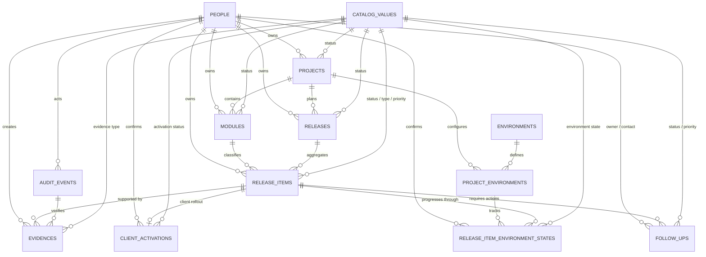
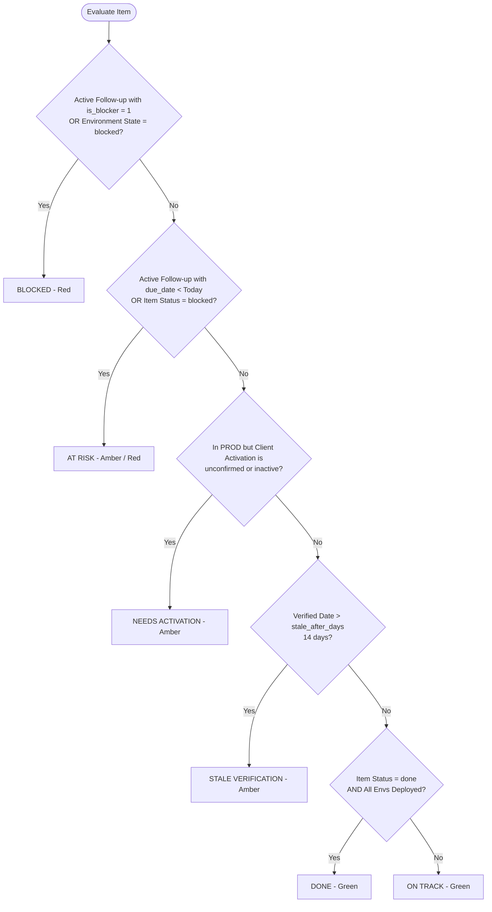

# Database Design — Project and Release Control Local MVP (v1.0)

**Technology:** MySQL 8.x / MariaDB 10.4+ · Laravel 10.x  
**Scope:** Local MVP for engineering release management  
**Pilot Project:** Reports (with modular expansion to EFT, EDI, Twine Sync, Fintrac, etc.)  
**Initial Environments:** MOJA, TATU, SITA, PROD  

---

## 1. Executive Summary & Architecture Principles

The Project and Release Control Database is a normalized relational schema engineered to coordinate and audit multi-environment software deployments, eliminate manual tracking overhead, decouple production infrastructure rollout from commercial client activation, and provide real-time visibility into release blockers and actionable items.

The database architecture maintains strict boundaries across the following domains:

1. **Inventory & Structure:** Hierarchy of projects, functional modules, coordinated releases, and granular release items.
2. **Multi-Environment Promotion Matrix:** Current deployment and verification state of each item across sequential environments (`MOJA` → `TATU` → `SITA` → `PROD`).
3. **Decoupled Client Activation:** Client availability and rollout scope, independently tracked from physical deployment in `PROD`.
4. **Normalized Coordination & Follow-ups:** Explicit action tracking with assignees (`owner`), contacts, due dates, blocker flags, and documented outcomes.
5. **Auditing & Verifiable Evidence:** Append-only log of critical state transitions and linkable references/attachments.
6. **Configurable Catalog & App Parameters:** Single-table polymorphic catalog values and typed JSON application configuration.
7. **Authentication:** Secure API token management via Laravel Sanctum.

> [!IMPORTANT]
> **Source of Truth:** Laravel database migrations inside [`backend/database/migrations/`](file:///c:/PROYECTOS/ReleaseControl_01/backend/database/migrations/) serve as the canonical source of truth for the database schema. All changes are versioned, documented, and executed through migration scripts.

---

## 2. Architectural Design Decisions

### 2.1 Identifier Strategy: `BIGINT UNSIGNED`
* The initial design draft (v0.1) considered 26-character ULIDs (`CHAR(26)`).
* In the implemented and validated schema (**v1.0**), all operational and catalog tables use **`BIGINT UNSIGNED AUTO_INCREMENT`** for primary keys and foreign keys.
* **Rationale:** Maximizes native compatibility with Laravel Eloquent (`foreignId()`), simplifies REST API routes and Angular frontend bindings, optimizes B-tree indexing in MySQL/MariaDB, and provides user-friendly sequential identifiers (e.g., Release Item `#1` to `#23`, Follow-up `#1` to `#50`).

### 2.2 Timestamps & Precision
* All technical execution timestamps are stored in UTC using **`DATETIME(6)`** for microsecond accuracy and deterministic ordering in audit trails.
* Pure business calendar dates without hours (such as `target_date` and `due_date`) are stored as **`DATE`**.
* Conversion to user-facing timezones (e.g., `America/Guayaquil`) occurs strictly within the presentation and API layer as defined by `app_settings.display_timezone`.

### 2.3 Soft Deletion Strategy
* Operational entities implement `deleted_at DATETIME(6)` via Laravel's `SoftDeletes` trait: `people`, `projects`, `modules`, `releases`, `release_items`, and `follow_ups`.
* `audit_events` is an **append-only** immutable log and never permits deletion.
* Catalogs and environment configurations toggle availability via `is_active TINYINT(1)` rather than physical deletion to preserve historical referential integrity.

### 2.4 Multi-Module Releases & 3NF Normalization
* A `release` belongs directly to a `project` and acts as a cross-cutting coordination envelope.
* A `release_item` belongs to a specific `module` and is associated with a `release`.
* **Normalization (August 17, 2026 Migrations):**
  - **`project_id` dropped from `release_items`:** Redundant composite foreign keys were eliminated (`2026_08_17_000002_drop_project_id_from_release_items_table.php`). The item's project is deterministically resolved via `module.project_id` and `release.project_id`.
  - **`next_action` dropped from `release_items`:** Freeform text next actions were removed (`2026_08_17_000001_drop_next_action_from_release_items_table.php`) in favor of first-class, normalized rows in the `follow_ups` table with dedicated owners, due dates, and blocker indicators.

### 2.5 Current State Matrix vs. Historical Audit Log
* **`release_item_environment_states`** retains solely the *current* state of an item in a specific project environment, guarded by a strict unique constraint: `UNIQUE(release_item_id, project_environment_id)`.
* **`audit_events`** preserves immutable snapshots of every meaningful change (status transitions, verifications, activations).
* **Computed Health:** Health statuses (`Blocked`, `At Risk`, `On Track`, `Done`) are dynamically computed at runtime and never persisted as redundant denormalized columns.

### 2.6 Single-Table Dynamic Catalog (`catalog_values`)
* Configurable categorizations share the `catalog_values` table: `project_status`, `module_status`, `release_status`, `release_item_status`, `release_item_type`, `priority`, `environment_state`, `activation_status`, `follow_up_status`, and `evidence_type`.
* Eliminates schema bloat while allowing live customization of colors, ordering, labels, and system flags without schema alterations.

---

## 3. Entity-Relationship Diagram (ERD)



---

## 4. Tables Summary

| Table | Category | Purpose | Primary Key | Soft Delete |
|---|---|---|---|:---:|
| [`people`](file:///c:/PROYECTOS/ReleaseControl_01/database/release_control_db_06.sql#L665) | Master Data | Team members, release leads, stakeholders, and confirmation contacts | `BIGINT UNSIGNED` | Yes |
| [`catalog_values`](file:///c:/PROYECTOS/ReleaseControl_01/database/release_control_db_06.sql#L322) | Config / Catalog | Centralized enumerated values (statuses, priorities, types, colors) | `BIGINT UNSIGNED` | No |
| [`projects`](file:///c:/PROYECTOS/ReleaseControl_01/database/release_control_db_06.sql#L724) | Operational | Root engineering projects under control (e.g., Reports) | `BIGINT UNSIGNED` | Yes |
| [`modules`](file:///c:/PROYECTOS/ReleaseControl_01/database/release_control_db_06.sql#L621) | Operational | Functional sub-domains or services within projects | `BIGINT UNSIGNED` | Yes |
| [`releases`](file:///c:/PROYECTOS/ReleaseControl_01/database/release_control_db_06.sql#L788) | Operational | Multi-module deployment milestone packages | `BIGINT UNSIGNED` | Yes |
| [`release_items`](file:///c:/PROYECTOS/ReleaseControl_01/database/release_control_db_06.sql#L832) | Operational | Atomic tracking unit of deployable functionality | `BIGINT UNSIGNED` | Yes |
| [`environments`](file:///c:/PROYECTOS/ReleaseControl_01/database/release_control_db_06.sql#L453) | Master Data | Global deployment stages (MOJA, TATU, SITA, PROD) | `BIGINT UNSIGNED` | No |
| [`project_environments`](file:///c:/PROYECTOS/ReleaseControl_01/database/release_control_db_06.sql#L752) | Configuration | Ordered, project-specific environment pipeline bindings | `BIGINT UNSIGNED` | No |
| [`release_item_environment_states`](file:///c:/PROYECTOS/ReleaseControl_01/database/release_control_db_06.sql#L887) | Current State | Live environment matrix tracking per item/environment | `BIGINT UNSIGNED` | No |
| [`client_activations`](file:///c:/PROYECTOS/ReleaseControl_01/database/release_control_db_06.sql#L401) | Current State | Production client availability, plan segmentation, and activation | `BIGINT UNSIGNED` | No |
| [`follow_ups`](file:///c:/PROYECTOS/ReleaseControl_01/database/release_control_db_06.sql#L503) | Operational | Action items, blocker flags, due dates, and resolutions | `BIGINT UNSIGNED` | Yes |
| [`audit_events`](file:///c:/PROYECTOS/ReleaseControl_01/database/release_control_db_06.sql#L57) | Audit / History | Append-only immutable log of critical modifications and transitions | `BIGINT UNSIGNED` | No |
| [`evidences`](file:///c:/PROYECTOS/ReleaseControl_01/database/release_control_db_06.sql#L481) | Documental | Verification links, Jira issues, Teams chat refs, and local docs | `BIGINT UNSIGNED` | No |
| [`app_settings`](file:///c:/PROYECTOS/ReleaseControl_01/database/release_control_db_06.sql#L33) | Configuration | Typed key-value application preferences (JSON payload) | `VARCHAR(100)` | No |
| [`personal_access_tokens`](file:///c:/PROYECTOS/ReleaseControl_01/database/release_control_db_06.sql#L704) | Security | Laravel Sanctum API client authentication tokens | `BIGINT UNSIGNED` | No |

---

## 5. Detailed Data Dictionary

### 5.1 `people`
Represents individuals cited as project owners, item owners, assignees, contacts, or confirmation authors.

| Column | Type | Nullable | Default | Description / Rules |
|---|---|:---:|---|---|
| `id` | `BIGINT(20) UNSIGNED` | No | `AUTO_INCREMENT` | Primary Key |
| `display_name` | `VARCHAR(150)` | No | — | Visible full name (e.g., 'Ximena Alvear', 'Ameet') |
| `email` | `VARCHAR(190)` | Yes | `NULL` | Contact email (unique when provided) |
| `role_title` | `VARCHAR(120)` | Yes | `NULL` | Business role (e.g., 'Product Owner', 'QA Lead') |
| `team` | `VARCHAR(120)` | Yes | `NULL` | Organization / Scrum team name |
| `is_active` | `TINYINT(1)` | No | `1` | Active flag for assignee selectors |
| `created_at` | `DATETIME(6)` | No | — | Creation timestamp in UTC |
| `updated_at` | `DATETIME(6)` | No | — | Update timestamp in UTC |
| `deleted_at` | `DATETIME(6)` | Yes | `NULL` | Soft delete timestamp |

* **Indexes & Constraints:**
  - `PRIMARY KEY (id)`
  - `UNIQUE KEY people_email_unique (email)`
  - `KEY people_display_name_index (display_name)`
  - `KEY people_is_active_index (is_active)`

---

### 5.2 `catalog_values`
Central catalog for all configurable business classifications and visual styles.

| Column | Type | Nullable | Default | Description / Rules |
|---|---|:---:|---|---|
| `id` | `BIGINT(20) UNSIGNED` | No | `AUTO_INCREMENT` | Primary Key |
| `category` | `VARCHAR(50)` | No | — | Functional category key |
| `code` | `VARCHAR(50)` | No | — | Stable programmatic identifier |
| `label` | `VARCHAR(100)` | No | — | Display label in UI |
| `description` | `VARCHAR(255)` | Yes | `NULL` | Operational explanation |
| `sort_order` | `SMALLINT(5) UNSIGNED` | No | `0` | Sequence ordering in dropdowns |
| `color` | `CHAR(7)` | Yes | `NULL` | Hex color code (e.g., `#10B981`) |
| `is_system` | `TINYINT(1)` | No | `0` | If `1`, protected from deletion |
| `is_active` | `TINYINT(1)` | No | `1` | Active availability flag |
| `created_at` | `DATETIME(6)` | No | — | UTC creation timestamp |
| `updated_at` | `DATETIME(6)` | No | — | UTC update timestamp |

* **Indexes & Constraints:**
  - `PRIMARY KEY (id)`
  - `UNIQUE KEY catalog_values_category_code_unique (category, code)`
  - `KEY catalog_values_category_is_active_sort_order_index (category, is_active, sort_order)`

---

### 5.3 `projects`
Root project envelope managed by the application.

| Column | Type | Nullable | Default | Description / Rules |
|---|---|:---:|---|---|
| `id` | `BIGINT(20) UNSIGNED` | No | `AUTO_INCREMENT` | Primary Key |
| `name` | `VARCHAR(120)` | No | — | Unique active project name |
| `code` | `VARCHAR(40)` | No | — | Short identifier (e.g., 'REPORTS', 'EFT') |
| `description` | `TEXT` | Yes | `NULL` | High-level project charter |
| `status_id` | `BIGINT(20) UNSIGNED` | No | — | FK to `catalog_values.id` (`project_status`) |
| `owner_person_id` | `BIGINT(20) UNSIGNED` | Yes | `NULL` | FK to `people.id` (Project Lead) |
| `created_at` | `DATETIME(6)` | No | — | UTC creation timestamp |
| `updated_at` | `DATETIME(6)` | No | — | UTC update timestamp |
| `deleted_at` | `DATETIME(6)` | Yes | `NULL` | Soft delete timestamp |

* **Indexes & Foreign Keys:**
  - `PRIMARY KEY (id)`
  - `UNIQUE KEY projects_code_unique (code)`
  - `KEY projects_status_id_deleted_at_index (status_id, deleted_at)`
  - `KEY projects_owner_person_id_deleted_at_index (owner_person_id, deleted_at)`
  - `CONSTRAINT projects_owner_person_id_foreign FOREIGN KEY (owner_person_id) REFERENCES people (id) ON DELETE SET NULL`
  - `CONSTRAINT projects_status_id_foreign FOREIGN KEY (status_id) REFERENCES catalog_values (id)`

---

### 5.4 `modules`
Functional architectural areas or modules belonging to a project.

| Column | Type | Nullable | Default | Description / Rules |
|---|---|:---:|---|---|
| `id` | `BIGINT(20) UNSIGNED` | No | `AUTO_INCREMENT` | Primary Key |
| `project_id` | `BIGINT(20) UNSIGNED` | No | — | FK to `projects.id` |
| `name` | `VARCHAR(150)` | No | — | Module display name |
| `code` | `VARCHAR(50)` | No | — | Unique code within project |
| `description` | `TEXT` | Yes | `NULL` | Functional description |
| `status_id` | `BIGINT(20) UNSIGNED` | No | — | FK to `catalog_values.id` (`module_status`) |
| `owner_person_id` | `BIGINT(20) UNSIGNED` | Yes | `NULL` | FK to `people.id` (Module Lead) |
| `created_at` | `DATETIME(6)` | No | — | UTC creation timestamp |
| `updated_at` | `DATETIME(6)` | No | — | UTC update timestamp |
| `deleted_at` | `DATETIME(6)` | Yes | `NULL` | Soft delete timestamp |

* **Indexes & Foreign Keys:**
  - `PRIMARY KEY (id)`
  - `UNIQUE KEY modules_project_id_code_unique (project_id, code)`
  - `KEY modules_project_id_status_id_deleted_at_index (project_id, status_id, deleted_at)`
  - `CONSTRAINT modules_project_id_foreign FOREIGN KEY (project_id) REFERENCES projects (id)`
  - `CONSTRAINT modules_owner_person_id_foreign FOREIGN KEY (owner_person_id) REFERENCES people (id) ON DELETE SET NULL`
  - `CONSTRAINT modules_status_id_foreign FOREIGN KEY (status_id) REFERENCES catalog_values (id)`

---

### 5.5 `releases`
Coordinated release package aggregating functionality scheduled for promotion.

| Column | Type | Nullable | Default | Description / Rules |
|---|---|:---:|---|---|
| `id` | `BIGINT(20) UNSIGNED` | No | `AUTO_INCREMENT` | Primary Key |
| `project_id` | `BIGINT(20) UNSIGNED` | No | — | FK to `projects.id` |
| `name` | `VARCHAR(150)` | No | — | Release title (e.g., 'Release 2026-08-31') |
| `code` | `VARCHAR(60)` | No | — | Unique code within project (e.g., 'REL-2026-08-31') |
| `scope` | `TEXT` | Yes | `NULL` | High-level scope summary |
| `status_id` | `BIGINT(20) UNSIGNED` | No | — | FK to `catalog_values.id` (`release_status`) |
| `owner_person_id` | `BIGINT(20) UNSIGNED` | Yes | `NULL` | FK to `people.id` (Release Coordinator) |
| `target_date` | `DATE` | Yes | `NULL` | Planned target deployment date |
| `started_at` | `DATETIME(6)` | Yes | `NULL` | Actual kickoff date/time |
| `completed_at` | `DATETIME(6)` | Yes | `NULL` | Final completion timestamp |
| `release_notes_url`| `VARCHAR(2048)` | Yes | `NULL` | Confluence / doc link |
| `notes` | `TEXT` | Yes | `NULL` | Coordination notes |
| `created_at` | `DATETIME(6)` | No | — | UTC creation timestamp |
| `updated_at` | `DATETIME(6)` | No | — | UTC update timestamp |
| `deleted_at` | `DATETIME(6)` | Yes | `NULL` | Soft delete timestamp |

* **Indexes & Foreign Keys:**
  - `PRIMARY KEY (id)`
  - `UNIQUE KEY releases_project_id_code_unique (project_id, code)`
  - `KEY releases_project_id_status_id_target_date_index (project_id, status_id, target_date)`
  - `CONSTRAINT releases_project_id_foreign FOREIGN KEY (project_id) REFERENCES projects (id)`
  - `CONSTRAINT releases_owner_person_id_foreign FOREIGN KEY (owner_person_id) REFERENCES people (id) ON DELETE SET NULL`
  - `CONSTRAINT releases_status_id_foreign FOREIGN KEY (status_id) REFERENCES catalog_values (id)`

---

### 5.6 `release_items`
Granular unit of deployable scope (feature, bugfix, or base release package).

| Column | Type | Nullable | Default | Description / Rules |
|---|---|:---:|---|---|
| `id` | `BIGINT(20) UNSIGNED` | No | `AUTO_INCREMENT` | Primary Key |
| `release_id` | `BIGINT(20) UNSIGNED` | No | — | FK to `releases.id` |
| `module_id` | `BIGINT(20) UNSIGNED` | No | — | FK to `modules.id` |
| `title` | `VARCHAR(200)` | No | — | Short descriptive title |
| `description` | `TEXT` | Yes | `NULL` | Detailed technical scope |
| `item_type_id` | `BIGINT(20) UNSIGNED` | No | — | FK to `catalog_values.id` (`release_item_type`) |
| `status_id` | `BIGINT(20) UNSIGNED` | No | — | FK to `catalog_values.id` (`release_item_status`) |
| `priority_id` | `BIGINT(20) UNSIGNED` | No | — | FK to `catalog_values.id` (`priority`) |
| `owner_person_id` | `BIGINT(20) UNSIGNED` | Yes | `NULL` | FK to `people.id` (Item Tech Lead) |
| `jira_key` | `VARCHAR(40)` | Yes | `NULL` | Jira key (e.g., 'RPS-298') |
| `jira_url` | `VARCHAR(2048)` | Yes | `NULL` | Direct Jira URL link |
| `target_date` | `DATE` | Yes | `NULL` | Target readiness date |
| `closed_at` | `DATETIME(6)` | Yes | `NULL` | Closure timestamp |
| `created_at` | `DATETIME(6)` | No | — | UTC creation timestamp |
| `updated_at` | `DATETIME(6)` | No | — | UTC update timestamp |
| `deleted_at` | `DATETIME(6)` | Yes | `NULL` | Soft delete timestamp |

* **Normalization Notes:**
  - `project_id` was dropped via migration `2026_08_17_000002` (derived from `module.project_id`).
  - `next_action` was dropped via migration `2026_08_17_000001` (managed in `follow_ups`).
* **Indexes & Foreign Keys:**
  - `PRIMARY KEY (id)`
  - `KEY release_items_release_id_status_id_index (release_id, status_id)`
  - `KEY release_items_module_id_status_id_index (module_id, status_id)`
  - `KEY release_items_project_id_priority_id_target_date_index (priority_id, target_date)`
  - `CONSTRAINT release_items_release_id_foreign FOREIGN KEY (release_id) REFERENCES releases (id)`
  - `CONSTRAINT release_items_module_id_foreign FOREIGN KEY (module_id) REFERENCES modules (id)`
  - `CONSTRAINT release_items_item_type_id_foreign FOREIGN KEY (item_type_id) REFERENCES catalog_values (id)`
  - `CONSTRAINT release_items_status_id_foreign FOREIGN KEY (status_id) REFERENCES catalog_values (id)`
  - `CONSTRAINT release_items_priority_id_foreign FOREIGN KEY (priority_id) REFERENCES catalog_values (id)`
  - `CONSTRAINT release_items_owner_person_id_foreign FOREIGN KEY (owner_person_id) REFERENCES people (id) ON DELETE SET NULL`

---

### 5.7 `environments`
Global master catalog of available infrastructure environments.

| Column | Type | Nullable | Default | Description / Rules |
|---|---|:---:|---|---|
| `id` | `BIGINT(20) UNSIGNED` | No | `AUTO_INCREMENT` | Primary Key |
| `code` | `VARCHAR(30)` | No | — | Immutable code (`MOJA`, `TATU`, `SITA`, `PROD`) |
| `name` | `VARCHAR(80)` | No | — | Display name |
| `description` | `VARCHAR(255)` | Yes | `NULL` | Environment role/definition |
| `default_sequence` | `SMALLINT(5) UNSIGNED` | No | — | Standard pipeline position |
| `is_active` | `TINYINT(1)` | No | `1` | Active flag |
| `created_at` | `DATETIME(6)` | No | — | UTC creation timestamp |
| `updated_at` | `DATETIME(6)` | No | — | UTC update timestamp |

* **Indexes & Constraints:**
  - `PRIMARY KEY (id)`
  - `UNIQUE KEY environments_code_unique (code)`

---

### 5.8 `project_environments`
Configures which environments are enabled for a specific project and their sequential pipeline promotion order.

| Column | Type | Nullable | Default | Description / Rules |
|---|---|:---:|---|---|
| `id` | `BIGINT(20) UNSIGNED` | No | `AUTO_INCREMENT` | Primary Key |
| `project_id` | `BIGINT(20) UNSIGNED` | No | — | FK to `projects.id` |
| `environment_id` | `BIGINT(20) UNSIGNED` | No | — | FK to `environments.id` |
| `sequence` | `SMALLINT(5) UNSIGNED` | No | — | Promotion sequence (10, 20, 30, 40) |
| `is_required` | `TINYINT(1)` | No | `1` | If promotion gate is mandatory |
| `is_active` | `TINYINT(1)` | No | `1` | Currently active in workflow |
| `created_at` | `DATETIME(6)` | No | — | UTC creation timestamp |
| `updated_at` | `DATETIME(6)` | No | — | UTC update timestamp |

* **Indexes & Foreign Keys:**
  - `PRIMARY KEY (id)`
  - `UNIQUE KEY project_environments_project_id_environment_id_unique (project_id, environment_id)`
  - `UNIQUE KEY project_environments_project_id_sequence_unique (project_id, sequence)`
  - `KEY project_environments_project_id_is_active_sequence_index (project_id, is_active, sequence)`
  - `CONSTRAINT project_environments_project_id_foreign FOREIGN KEY (project_id) REFERENCES projects (id)`
  - `CONSTRAINT project_environments_environment_id_foreign FOREIGN KEY (environment_id) REFERENCES environments (id)`

---

### 5.9 `release_item_environment_states`
Normalized deployment matrix recording the exact current status of an item in a specific project environment.

| Column | Type | Nullable | Default | Description / Rules |
|---|---|:---:|---|---|
| `id` | `BIGINT(20) UNSIGNED` | No | `AUTO_INCREMENT` | Primary Key |
| `project_id` | `BIGINT(20) UNSIGNED` | No | — | FK to `projects.id` (Guarantees isolation) |
| `release_item_id` | `BIGINT(20) UNSIGNED` | No | — | FK to `release_items.id` |
| `project_environment_id` | `BIGINT(20) UNSIGNED` | No | — | FK to `project_environments.id` |
| `status_id` | `BIGINT(20) UNSIGNED` | No | — | FK to `catalog_values.id` (`environment_state`) |
| `status_changed_at` | `DATETIME(6)` | No | — | Timestamp when environment state changed |
| `verified_at` | `DATETIME(6)` | No | — | Timestamp of latest human/automated verification |
| `confirmed_by_person_id` | `BIGINT(20) UNSIGNED` | Yes | `NULL` | FK to `people.id` |
| `confirmed_by_text` | `VARCHAR(150)` | Yes | `NULL` | Free text confirmation author if not in people |
| `source_summary` | `VARCHAR(500)` | No | — | Evidence origin ('2026-08-07 meeting', etc.) |
| `notes` | `TEXT` | Yes | `NULL` | Operational context |
| `created_at` | `DATETIME(6)` | No | — | UTC creation timestamp |
| `updated_at` | `DATETIME(6)` | No | — | UTC update timestamp |

* **Integrity & Constraint Rules:**
  - Guaranteed exactly 1 state per item/environment via `UNIQUE KEY item_env_unique (release_item_id, project_environment_id)` (enforced via migration `2026_08_17_000003`).
  - Either `confirmed_by_person_id` or `confirmed_by_text` must be populated.
* **Indexes & Foreign Keys:**
  - `PRIMARY KEY (id)`
  - `UNIQUE KEY item_env_unique (release_item_id, project_environment_id)`
  - `KEY env_status_idx (project_environment_id, status_id)`
  - `KEY status_ver_idx (status_id, verified_at)`
  - `CONSTRAINT release_item_environment_states_project_id_foreign FOREIGN KEY (project_id) REFERENCES projects (id)`
  - `CONSTRAINT release_item_environment_states_release_item_id_foreign FOREIGN KEY (release_item_id) REFERENCES release_items (id)`
  - `CONSTRAINT release_item_environment_states_project_environment_id_foreign FOREIGN KEY (project_environment_id) REFERENCES project_environments (id)`
  - `CONSTRAINT release_item_environment_states_status_id_foreign FOREIGN KEY (status_id) REFERENCES catalog_values (id)`
  - `CONSTRAINT release_item_environment_states_confirmed_by_person_id_foreign FOREIGN KEY (confirmed_by_person_id) REFERENCES people (id) ON DELETE SET NULL`

---

### 5.10 `client_activations`
Tracks the business readiness and rollout of functionality to end clients, strictly independent from code presence in `PROD`.

| Column | Type | Nullable | Default | Description / Rules |
|---|---|:---:|---|---|
| `id` | `BIGINT(20) UNSIGNED` | No | `AUTO_INCREMENT` | Primary Key |
| `release_item_id` | `BIGINT(20) UNSIGNED` | No | — | FK to `release_items.id` (1:1 per item) |
| `status_id` | `BIGINT(20) UNSIGNED` | No | — | FK to `catalog_values.id` (`activation_status`) |
| `scope_type` | `VARCHAR(30)` | No | `'unknown'` | Scope category: `global`, `selective`, `off`, `not_applicable`, `unknown` |
| `scope_description`| `VARCHAR(500)` | Yes | `NULL` | Business description of activated client segment |
| `activated_at` | `DATETIME(6)` | Yes | `NULL` | When feature was toggled on for clients |
| `verified_at` | `DATETIME(6)` | No | — | Timestamp of verification review |
| `confirmed_by_person_id`| `BIGINT(20) UNSIGNED`| Yes | `NULL` | FK to `people.id` |
| `confirmed_by_text` | `VARCHAR(150)` | Yes | `NULL` | Free text confirmation author |
| `source_summary` | `VARCHAR(500)` | No | — | Review meeting or approval source |
| `notes` | `TEXT` | Yes | `NULL` | Client rollout notes |
| `created_at` | `DATETIME(6)` | No | — | UTC creation timestamp |
| `updated_at` | `DATETIME(6)` | No | — | UTC update timestamp |

* **Indexes & Foreign Keys:**
  - `PRIMARY KEY (id)`
  - `UNIQUE KEY client_activations_release_item_id_unique (release_item_id)`
  - `KEY client_activations_status_id_verified_at_index (status_id, verified_at)`
  - `CONSTRAINT client_activations_release_item_id_foreign FOREIGN KEY (release_item_id) REFERENCES release_items (id)`
  - `CONSTRAINT client_activations_status_id_foreign FOREIGN KEY (status_id) REFERENCES catalog_values (id)`
  - `CONSTRAINT client_activations_confirmed_by_person_id_foreign FOREIGN KEY (confirmed_by_person_id) REFERENCES people (id) ON DELETE SET NULL`

---

### 5.11 `follow_ups`
Action items, coordination requirements, and blockers tied to release items.

| Column | Type | Nullable | Default | Description / Rules |
|---|---|:---:|---|---|
| `id` | `BIGINT(20) UNSIGNED` | No | `AUTO_INCREMENT` | Primary Key |
| `release_item_id` | `BIGINT(20) UNSIGNED` | No | — | FK to `release_items.id` |
| `action` | `VARCHAR(500)` | No | — | Clear, actionable coordination statement |
| `status_id` | `BIGINT(20) UNSIGNED` | No | — | FK to `catalog_values.id` (`follow_up_status`) |
| `priority_id` | `BIGINT(20) UNSIGNED` | No | — | FK to `catalog_values.id` (`priority`) |
| `owner_person_id` | `BIGINT(20) UNSIGNED` | Yes | `NULL` | FK to `people.id` (Person responsible for execution) |
| `contact_person_id`| `BIGINT(20) UNSIGNED`| Yes | `NULL` | FK to `people.id` (Counterpart to contact, e.g., Ameet) |
| `due_date` | `DATE` | Yes | `NULL` | Target resolution deadline |
| `is_blocker` | `TINYINT(1)` | No | `0` | If `1`, triggers `Blocked` health on item |
| `notes` | `TEXT` | Yes | `NULL` | Background context / updates |
| `outcome` | `TEXT` | Yes | `NULL` | Result recorded upon closure |
| `completed_at` | `DATETIME(6)` | Yes | `NULL` | Closure timestamp in UTC |
| `created_at` | `DATETIME(6)` | No | — | UTC creation timestamp |
| `updated_at` | `DATETIME(6)` | No | — | UTC update timestamp |
| `deleted_at` | `DATETIME(6)` | Yes | `NULL` | Soft delete timestamp |

* **Indexes & Foreign Keys:**
  - `PRIMARY KEY (id)`
  - `KEY follow_ups_status_id_due_date_index (status_id, due_date)`
  - `KEY follow_ups_owner_person_id_status_id_due_date_index (owner_person_id, status_id, due_date)`
  - `KEY follow_ups_release_item_id_status_id_index (release_item_id, status_id)`
  - `KEY follow_ups_is_blocker_status_id_index (is_blocker, status_id)`
  - `CONSTRAINT follow_ups_release_item_id_foreign FOREIGN KEY (release_item_id) REFERENCES release_items (id)`
  - `CONSTRAINT follow_ups_status_id_foreign FOREIGN KEY (status_id) REFERENCES catalog_values (id)`
  - `CONSTRAINT follow_ups_priority_id_foreign FOREIGN KEY (priority_id) REFERENCES catalog_values (id)`
  - `CONSTRAINT follow_ups_owner_person_id_foreign FOREIGN KEY (owner_person_id) REFERENCES people (id) ON DELETE SET NULL`
  - `CONSTRAINT follow_ups_contact_person_id_foreign FOREIGN KEY (contact_person_id) REFERENCES people (id) ON DELETE SET NULL`

---

### 5.12 `audit_events`
Append-only immutable event ledger recording significant transitions across all entities.

| Column | Type | Nullable | Default | Description / Rules |
|---|---|:---:|---|---|
| `id` | `BIGINT(20) UNSIGNED` | No | `AUTO_INCREMENT` | Primary Key |
| `entity_type` | `VARCHAR(80)` | No | — | Stable morph alias (`project`, `release`, `release_item`, etc.) |
| `entity_id` | `BIGINT(20) UNSIGNED` | No | — | Target entity ID |
| `event_type` | `VARCHAR(80)` | No | — | Event code (`status_changed`, `created`, `verified`) |
| `changes` | `LONGTEXT JSON` | Yes | `NULL` | Before and after field values payload |
| `context` | `LONGTEXT JSON` | Yes | `NULL` | Additional context, IP, reason, source |
| `actor_person_id` | `BIGINT(20) UNSIGNED` | Yes | `NULL` | FK to `people.id` |
| `actor_name` | `VARCHAR(150)` | No | — | Author display name |
| `occurred_at` | `DATETIME(6)` | No | — | Event occurrence timestamp |
| `created_at` | `DATETIME(6)` | No | — | UTC creation timestamp |

* **Indexes & Constraints:**
  - `PRIMARY KEY (id)`
  - `KEY audit_events_entity_type_entity_id_occurred_at_index (entity_type, entity_id, occurred_at)`
  - `KEY audit_events_event_type_occurred_at_index (event_type, occurred_at)`
  - `KEY audit_events_actor_person_id_occurred_at_index (actor_person_id, occurred_at)`
  - `CONSTRAINT audit_events_actor_person_id_foreign FOREIGN KEY (actor_person_id) REFERENCES people (id) ON DELETE SET NULL`

---

### 5.13 `evidences`
Documentary references, Jira tickets, web links, or meeting notes corroborating approvals and status promotions.

| Column | Type | Nullable | Default | Description / Rules |
|---|---|:---:|---|---|
| `id` | `BIGINT(20) UNSIGNED` | No | `AUTO_INCREMENT` | Primary Key |
| `release_item_id` | `BIGINT(20) UNSIGNED` | No | — | FK to `release_items.id` |
| `audit_event_id` | `BIGINT(20) UNSIGNED` | Yes | `NULL` | FK to `audit_events.id` |
| `evidence_type_id` | `BIGINT(20) UNSIGNED` | No | — | FK to `catalog_values.id` (`evidence_type`) |
| `title` | `VARCHAR(200)` | No | — | Descriptive title |
| `reference_url` | `VARCHAR(2048)` | Yes | `NULL` | Web URL or ticket link |
| `local_path` | `VARCHAR(1000)` | Yes | `NULL` | Sanitized local file path relative to storage root |
| `description` | `TEXT` | Yes | `NULL` | Detailed note |
| `captured_at` | `DATETIME(6)` | No | — | Time evidence was captured |
| `created_by_person_id` | `BIGINT(20) UNSIGNED` | Yes | `NULL` | FK to `people.id` |
| `created_at` | `DATETIME(6)` | No | — | UTC creation timestamp |
| `updated_at` | `DATETIME(6)` | No | — | UTC update timestamp |

* **Indexes & Foreign Keys:**
  - `PRIMARY KEY (id)`
  - `KEY evidences_release_item_id_captured_at_index (release_item_id, captured_at)`
  - `KEY evidences_audit_event_id_foreign (audit_event_id)`
  - `CONSTRAINT evidences_release_item_id_foreign FOREIGN KEY (release_item_id) REFERENCES release_items (id)`
  - `CONSTRAINT evidences_evidence_type_id_foreign FOREIGN KEY (evidence_type_id) REFERENCES catalog_values (id)`
  - `CONSTRAINT evidences_audit_event_id_foreign FOREIGN KEY (audit_event_id) REFERENCES audit_events (id) ON DELETE SET NULL`
  - `CONSTRAINT evidences_created_by_person_id_foreign FOREIGN KEY (created_by_person_id) REFERENCES people (id) ON DELETE SET NULL`

---

### 5.14 `app_settings`
Global application runtime preferences stored as typed JSON key-values.

| Column | Type | Nullable | Default | Description / Rules |
|---|---|:---:|---|---|
| `key` | `VARCHAR(100)` | No | — | Primary Key configuration name |
| `value` | `LONGTEXT JSON` | No | — | Validated JSON payload (`CHECK (json_valid(value))`) |
| `description` | `VARCHAR(255)` | Yes | `NULL` | Configuration description |
| `updated_at` | `DATETIME(6)` | No | — | Last updated timestamp |

* **Production Key Seed Values:**
  - `default_project_code`: `"REPORTS"`
  - `display_timezone`: `"America/Guayaquil"`
  - `evidence_storage_mode`: `"reference_only"`
  - `stale_after_days`: `14`

---

### 5.15 `personal_access_tokens`
Laravel Sanctum API authentication tokens table.

| Column | Type | Nullable | Default | Description / Rules |
|---|---|:---:|---|---|
| `id` | `BIGINT(20) UNSIGNED` | No | `AUTO_INCREMENT` | Primary Key |
| `tokenable_type` | `VARCHAR(255)` | No | — | Polymorphic model class |
| `tokenable_id` | `BIGINT(20) UNSIGNED` | No | — | Polymorphic model ID |
| `name` | `VARCHAR(255)` | No | — | Token descriptive name |
| `token` | `VARCHAR(64)` | No | — | SHA-256 hashed token |
| `abilities` | `TEXT` | Yes | `NULL` | Granted scopes / permissions |
| `last_used_at` | `TIMESTAMP` | Yes | `NULL` | Last usage timestamp |
| `expires_at` | `TIMESTAMP` | Yes | `NULL` | Expiration timestamp |
| `created_at` | `TIMESTAMP` | Yes | `NULL` | Creation timestamp |
| `updated_at` | `TIMESTAMP` | Yes | `NULL` | Update timestamp |

---

## 6. Seed Data & Catalog Values Reference

### 6.1 Environments Pipeline

| ID | Code | Name | Sequence | Role |
|:---:|---|---|:---:|---|
| 1 | `MOJA` | MOJA | 10 | Development / Feature Integration |
| 2 | `TATU` | TATU | 20 | Quality Assurance & Testing |
| 3 | `SITA` | SITA | 30 | Staging / Pre-Production Validation |
| 4 | `PROD` | PROD | 40 | Production Environment |

### 6.2 Environment States (`environment_state`)

| ID | Code | Label | Color | Order | Description |
|:---:|---|---|:---:|:---:|---|
| 24 | `not_reached` | Not reached | `#9CA3AF` | 10 | The release unit has not reached the environment |
| 25 | `development` | Development | `#187EFB` | 20 | Active development in progress in environment |
| 26 | `ready_to_promote` | Ready to promote | `#A78BFA` | 25 | Validated and ready for promotion to next stage |
| 27 | `code_merging` | Code merging | `#F59E0B` | 30 | Merge or deployment preparation active |
| 28 | `deployed` | Deployed | `#73A6F7` | 40 | Presence confirmed; test result pending |
| 29 | `in_testing` | Testing | `#F59E0B` | 50 | Presence confirmed and QA validation in progress |
| 30 | `QASignoff` | QA - Signoff | `#10B981` | 60 | QA signed-off; presence and validation confirmed |
| 52 | `POSignoff` | PO - Sign off | `#6EE61E` | 65 | Product Owner signed-off and approved |
| 31 | `blocked` | Blocked | `#EF4444` | 70 | Item cannot progress due to dependency or blocker |
| 32 | `unconfirmed` | Unconfirmed | `#F97316` | 80 | Status or presence requires confirmation |

### 6.3 Client Activation Statuses (`activation_status`)

| ID | Code | Label | Color | Order | Description |
|:---:|---|---|:---:|:---:|---|
| 49 | `growth` | Growth | `#108981` | 10 | Enabled for Growth Plan clients |
| 50 | `bBasic` | Business Basic | `#0DE7BF` | 20 | Enabled for Business Basic Plan clients |
| 51 | `bPlus` | Business Plus V2 | `#36ECBC` | 30 | Enabled for Business Plus Plan clients |
| 37 | `active` | Active for Clients | `#97F7D7` | 40 | Fully enabled for the intended client scope |
| 35 | `inactive` | Deployed to PROD — Not released to clients | `#F59E0B` | 50 | In PROD but explicitly not toggled for clients |
| 33 | `not_applicable` | N/A | `#9CA3AF` | 60 | Activation not applicable before production |
| 36 | `limit` | Limit | `#8B5CF6` | 70 | Enabled for a limited pilot group of companies |
| 34 | `unconfirmed` | Unconfirmed | `#F97316` | 80 | Client access status needs verification |

### 6.4 Follow-up Statuses (`follow_up_status`)

| ID | Code | Label | Color | Order | Description |
|:---:|---|---|:---:|:---:|---|
| 38 | `pending` | Pending | `#F59E0B` | 10 | Action has not started |
| 39 | `in_progress` | In Progress | `#3B82F6` | 20 | Action is actively being worked |
| 40 | `waiting` | Waiting Dependency | `#8B5CF6` | 30 | Action depends on another person or event |
| 41 | `completed` | Completed | `#10B981` | 40 | Result and evidence recorded |
| 42 | `cancelled` | Cancelled | `#6B7280` | 50 | Action no longer required; reason documented |

### 6.5 Priorities (`priority`)

| ID | Code | Label | Color | Order | Description |
|:---:|---|---|:---:|:---:|---|
| 20 | `critical` | Critical | `#DC2626` | 10 | Immediate business, client, or release risk |
| 21 | `high` | High | `#F59E0B` | 20 | Requires active follow-up in current sprint |
| 22 | `medium` | Medium | `#3B82F6` | 30 | Important but not currently blocking release |
| 23 | `low` | Low | `#10B981` | 40 | Can be addressed after higher-priority items |

### 6.6 Evidence Types (`evidence_type`)

| ID | Code | Label | Color | Description |
|:---:|---|---|:---:|---|
| 43 | `meeting` | Meeting Confirmation | `#3B82F6` | Meeting alignment or verbal confirmation |
| 44 | `jira` | Jira Ticket | `#0052CC` | Jira ticket link or issue tracker reference |
| 45 | `teams` | Teams Chat | `#6264A7` | Microsoft Teams chat / channel confirmation |
| 46 | `email` | Email | `#EA4335` | Email thread or formal sign-off message |
| 47 | `url` | Web Link | `#10B981` | Web link or documentation reference |
| 48 | `local_file` | Local Reference File | `#6B7280` | Local document or log file reference |

---

## 7. Dynamic Health Status Calculation

The overall health status of an item or release is never stored as a denormalized column; it is dynamically calculated using deterministic precedence:



### Calculation Precedence Rules:
1. **`Blocked` (Red):** Any active `follow_up` (`pending`, `in_progress`, `waiting`) has `is_blocker = 1`, or any environment state is set to `blocked`.
2. **`At Risk` (Amber / Red):** Any active `follow_up` has `due_date < current_date()`, or `release_item.status_id` is `blocked`.
3. **`Needs Follow-up / Activation` (Amber):** Item is deployed to `PROD` (`deployed`, `QASignoff`, or `POSignoff`), but `client_activations.status_id` remains `unconfirmed` or `inactive`.
4. **`Stale Verification` (Amber):** Most recent `verified_at` timestamp is older than `app_settings.stale_after_days` (14 days).
5. **`Done` (Green):** Item status is `done` and client activation is satisfied.
6. **`On Track` (Green):** Work is in progress and none of the risk/blocker conditions are met.

---

## 8. Transactional Workflows & Constraints

### 8.1 Environment Matrix Update Workflow
When an item's environment status is changed in the UI:
1. Wrap all steps in a single atomic database transaction (`DB::transaction`).
2. Verify that `project_environments.project_id` matches `modules.project_id`.
3. Lock existing row via `SELECT ... FOR UPDATE` on `release_item_environment_states`.
4. Update `status_id`, `status_changed_at`, `verified_at`, `confirmed_by_person_id` / `confirmed_by_text`, and `source_summary`.
5. Insert row into `audit_events` with serialized JSON before/after snapshots.
6. If evidence link is provided, insert row into `evidences` linked to the `audit_event_id`.
7. Commit transaction.

### 8.2 Client Activation Update Workflow
1. Verify `scope_type` is valid (`global`, `selective`, `off`, `not_applicable`, `unknown`).
2. Require verification date, source summary, and confirmed author.
3. Upsert `client_activations` record.
4. Record corresponding `audit_events` row.

### 8.3 Follow-up Resolution Workflow
1. When status is transitioned to `completed` (ID 41), require `outcome` and stamp `completed_at = now()`.
2. If `is_blocker = 1`, resolving the follow-up instantly clears the blocker from the item's calculated health.
3. Record transition in `audit_events`.

---

## 9. Migration Roadmap & Schema Version History

The database has progressed through the following migration history:

| Migration File | Date | Description |
|---|:---:|---|
| [`2026_08_15_000001_create_people_table.php`](file:///c:/PROYECTOS/ReleaseControl_01/backend/database/migrations/2026_08_15_000001_create_people_table.php) | 2026-08-15 | Creates `people` master table |
| [`2026_08_15_000002_create_catalog_values_table.php`](file:///c:/PROYECTOS/ReleaseControl_01/backend/database/migrations/2026_08_15_000002_create_catalog_values_table.php) | 2026-08-15 | Creates centralized catalog table |
| [`2026_08_15_000003_create_projects_table.php`](file:///c:/PROYECTOS/ReleaseControl_01/backend/database/migrations/2026_08_15_000003_create_projects_table.php) | 2026-08-15 | Creates `projects` table |
| [`2026_08_15_000004_create_modules_table.php`](file:///c:/PROYECTOS/ReleaseControl_01/backend/database/migrations/2026_08_15_000004_create_modules_table.php) | 2026-08-15 | Creates `modules` table |
| [`2026_08_15_000005_create_releases_table.php`](file:///c:/PROYECTOS/ReleaseControl_01/backend/database/migrations/2026_08_15_000005_create_releases_table.php) | 2026-08-15 | Creates `releases` table |
| [`2026_08_15_000006_create_release_items_table.php`](file:///c:/PROYECTOS/ReleaseControl_01/backend/database/migrations/2026_08_15_000006_create_release_items_table.php) | 2026-08-15 | Creates `release_items` table |
| [`2026_08_15_000007_create_environments_table.php`](file:///c:/PROYECTOS/ReleaseControl_01/backend/database/migrations/2026_08_15_000007_create_environments_table.php) | 2026-08-15 | Creates master `environments` table |
| [`2026_08_15_000008_create_project_environments_table.php`](file:///c:/PROYECTOS/ReleaseControl_01/backend/database/migrations/2026_08_15_000008_create_project_environments_table.php) | 2026-08-15 | Creates project-environment bindings |
| [`2026_08_15_000009_create_release_item_environment_states_table.php`](file:///c:/PROYECTOS/ReleaseControl_01/backend/database/migrations/2026_08_15_000009_create_release_item_environment_states_table.php) | 2026-08-15 | Creates environment promotion matrix |
| [`2026_08_15_000010_create_client_activations_table.php`](file:///c:/PROYECTOS/ReleaseControl_01/backend/database/migrations/2026_08_15_000010_create_client_activations_table.php) | 2026-08-15 | Creates client activation table |
| [`2026_08_15_000011_create_follow_ups_table.php`](file:///c:/PROYECTOS/ReleaseControl_01/backend/database/migrations/2026_08_15_000011_create_follow_ups_table.php) | 2026-08-15 | Creates `follow_ups` action items table |
| [`2026_08_15_000012_create_audit_events_table.php`](file:///c:/PROYECTOS/ReleaseControl_01/backend/database/migrations/2026_08_15_000012_create_audit_events_table.php) | 2026-08-15 | Creates immutable audit events ledger |
| [`2026_08_15_000013_create_evidences_table.php`](file:///c:/PROYECTOS/ReleaseControl_01/backend/database/migrations/2026_08_15_000013_create_evidences_table.php) | 2026-08-15 | Creates verification evidence table |
| [`2026_08_15_000014_create_app_settings_table.php`](file:///c:/PROYECTOS/ReleaseControl_01/backend/database/migrations/2026_08_15_000014_create_app_settings_table.php) | 2026-08-15 | Creates typed JSON settings table |
| [`2026_08_17_000001_drop_next_action_from_release_items_table.php`](file:///c:/PROYECTOS/ReleaseControl_01/backend/database/migrations/2026_08_17_000001_drop_next_action_from_release_items_table.php) | 2026-08-17 | **Normalization:** Drops freeform `next_action` |
| [`2026_08_17_000002_drop_project_id_from_release_items_table.php`](file:///c:/PROYECTOS/ReleaseControl_01/backend/database/migrations/2026_08_17_000002_drop_project_id_from_release_items_table.php) | 2026-08-17 | **Normalization:** Drops redundant `project_id` |
| [`2026_08_17_000003_cleanup_and_unique_release_item_environment_states.php`](file:///c:/PROYECTOS/ReleaseControl_01/backend/database/migrations/2026_08_17_000003_cleanup_and_unique_release_item_environment_states.php) | 2026-08-17 | **Data Integrity:** Cleans orphaned states and enforces `item_env_unique` |

---

## 10. Operational Backup & Disaster Recovery

* **Database Dumps:** Automated `mysqldump` backups generated with timestamped filenames into `database/release_control_db_*.sql`.
* **Current Active Production Snapshot:** [`database/release_control_db_06.sql`](file:///c:/PROYECTOS/ReleaseControl_01/database/release_control_db_06.sql) (includes full operational baseline, catalog configurations, and test suites).
* **Restoration Procedure:**
  ```bash
  mysql -u root -p release_control_db < database/release_control_db_06.sql
  ```
* **Migration Verification:**
  ```bash
  cd backend
  php artisan migrate:status
  ```
