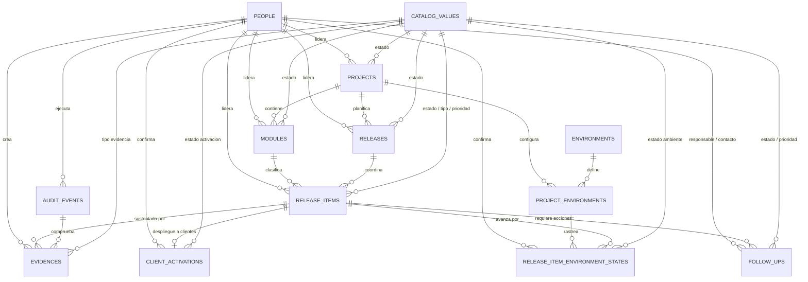
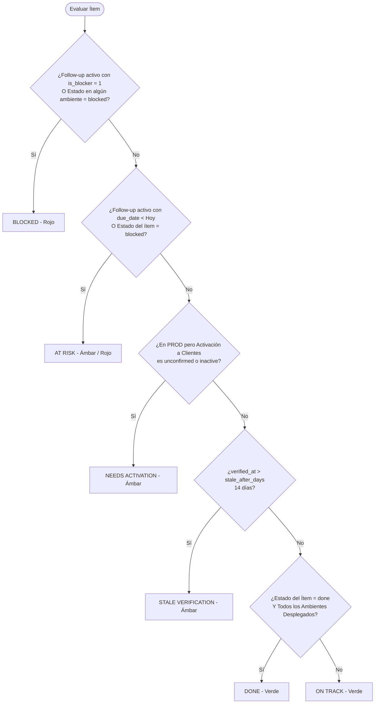

# Diseño de Base de Datos — Control de Proyectos y Releases Local MVP (v1.0)

**Tecnología:** MySQL 8.x / MariaDB 10.4+ · Laravel 10.x  
**Alcance:** MVP local para gestión y control de releases de ingeniería  
**Proyecto piloto:** Reports (con extensión modular a EFT, EDI, Twine Sync, Fintrac, etc.)  
**Ambientes iniciales:** MOJA, TATU, SITA, PROD  

---

## 1. Resumen Ejecutivo y Principios de Arquitectura

La base de datos de Control de Proyectos y Releases es un esquema relacional normalizado diseñado para coordinar y auditar despliegues de software multiamiente, eliminar la carga operativa del seguimiento manual, desacoplar el despliegue técnico en infraestructura de producción respecto a la activación comercial para clientes, y ofrecer visibilidad en tiempo real de bloqueos y acciones pendientes.

La arquitectura de la base de datos mantiene fronteras estrictas entre los siguientes dominios:

1. **Inventario y Estructura:** Jerarquía de proyectos, módulos funcionales, releases coordinadas e ítems de release atómicos.
2. **Matriz de Promoción Multiamiente:** Estado actual de despliegue y verificación de cada ítem a través de los ambientes secuenciales (`MOJA` → `TATU` → `SITA` → `PROD`).
3. **Activación de Clientes Desacoplada:** Disponibilidad y alcance de activación para clientes, rastreada de forma totalmente independiente del despliegue físico en `PROD`.
4. **Coordinación y Seguimiento Normalizados:** Registro explícito de acciones con responsables (`owner`), contactos, fechas objetivo, indicadores de bloqueo (`is_blocker`) y resultados documentados (`outcome`).
5. **Auditoría y Evidencia Verificable:** Registro inmutable *append-only* de transiciones de estado críticas y referencias/adjuntos comprobables.
6. **Catálogos Configurables y Parámetros Operativos:** Tabla polimórfica única de valores de catálogo y configuración de aplicación tipada en JSON.
7. **Autenticación:** Gestión segura de tokens de API mediante Laravel Sanctum.

> [!IMPORTANT]
> **Fuente de Verdad:** Las migraciones de base de datos en [`backend/database/migrations/`](file:///c:/PROYECTOS/ReleaseControl_01/backend/database/migrations/) constituyen la fuente canónica de verdad de la estructura. Todo cambio en el esquema se versiona, revisa y ejecuta a través de migraciones dentro del repositorio.

---

## 2. Decisiones de Diseño de Arquitectura

### 2.1 Estrategia de Identificadores: `BIGINT UNSIGNED`
* El borrador inicial de diseño (v0.1) propuso identificadores ULID de 26 caracteres (`CHAR(26)`).
* En el esquema implementado y validado (**v1.0**), todas las tablas operativas y de catálogo utilizan **`BIGINT UNSIGNED AUTO_INCREMENT`** para sus claves primarias y foráneas.
* **Justificación:** Maximiza la compatibilidad nativa con Laravel Eloquent (`foreignId()`), simplifica las rutas API REST y los enlaces en el frontend Angular, optimiza la indexación en árboles B en MySQL/MariaDB y facilita la identificación secuencial amigable para el usuario (ej. Ítems `#1` a `#23`, Seguimientos `#1` a `#50`).

### 2.2 Marcas de Tiempo y Precisión
* Todos los instantes técnicos de ejecución se almacenan en UTC mediante **`DATETIME(6)`** para garantizar precisión de microsegundos y orden determinista en pistas de auditoría.
* Las fechas de negocio sin hora (como `target_date` y `due_date`) se almacenan como **`DATE`**.
* La conversión a la zona horaria visual (ej. `America/Guayaquil`) se ejecuta exclusivamente en la capa de presentación y API según lo configurado en `app_settings.display_timezone`.

### 2.3 Estrategia de Eliminación Lógica (*Soft Deletes*)
* Las entidades operativas implementan `deleted_at DATETIME(6)` mediante el trait `SoftDeletes` de Laravel: `people`, `projects`, `modules`, `releases`, `release_items` y `follow_ups`.
* `audit_events` es un registro inmutable **append-only** y no admite eliminación.
* Los catálogos y ambientes configuran disponibilidad mediante `is_active TINYINT(1)` en lugar de eliminación física para preservar la integridad referencial histórica.

### 2.4 Releases Multimódulo y Normalización en 3FN
* Una release pertenece directamente a un `proyecto` y actúa como unidad de coordinación transversal.
* Un `release_item` pertenece a un `módulo` específico y está asociado a una `release`.
* **Normalización (Migraciones del 17 de agosto de 2026):**
  - **Eliminación de `project_id` en `release_items`:** Se eliminaron las llaves foráneas compuestas redundantes ([migración 000002](file:///c:/PROYECTOS/ReleaseControl_01/backend/database/migrations/2026_08_17_000002_drop_project_id_from_release_items_table.php)). El proyecto de un ítem se resuelve de forma determinista mediante `module.project_id` y `release.project_id`.
  - **Eliminación de `next_action` en `release_items`:** Se eliminó el campo de texto libre ([migración 000001](file:///c:/PROYECTOS/ReleaseControl_01/backend/database/migrations/2026_08_17_000001_drop_next_action_from_release_items_table.php)) para centralizar toda acción, responsable, fecha y bloqueo exclusivamente en filas normalizadas dentro de la tabla `follow_ups`.

### 2.5 Estado Actual vs. Historial de Auditoría
* **`release_item_environment_states`** almacena exclusivamente el estado *actual* de un ítem en un ambiente de proyecto determinado, protegido por una restricción de unicidad estricta: `UNIQUE(release_item_id, project_environment_id)`.
* **`audit_events`** preserva instantáneas inmutables de cada modificación relevante (cambios de estado, verificaciones, activaciones).
* **Salud Calculada:** La salud (`Blocked`, `At Risk`, `On Track`, `Done`) se calcula dinámicamente en tiempo de ejecución a partir de los datos y nunca se almacena como columna desnormalizada.

### 2.6 Catálogo Dinámico en Tabla Única (`catalog_values`)
* Los valores configurables comparten la tabla `catalog_values`: `project_status`, `module_status`, `release_status`, `release_item_status`, `release_item_type`, `priority`, `environment_state`, `activation_status`, `follow_up_status` y `evidence_type`.
* Elimina la proliferación de tablas pequeñas a la vez que permite personalizar en caliente colores, orden, etiquetas y estados activos sin alterar el esquema.

---

## 3. Diagrama Entidad-Relación (ERD)



---

## 4. Resumen de Tablas del Sistema

| Tabla | Categoría | Propósito | Clave Primaria | Borrado Lógico |
|---|---|---|---|:---:|
| [`people`](file:///c:/PROYECTOS/ReleaseControl_01/database/release_control_db_06.sql#L665) | Maestra | Personas que actúan como owners, contactos o autores de confirmación | `BIGINT UNSIGNED` | Sí |
| [`catalog_values`](file:///c:/PROYECTOS/ReleaseControl_01/database/release_control_db_06.sql#L322) | Config / Catálogo | Opciones enumeradas centralizadas (estados, prioridades, tipos, colores) | `BIGINT UNSIGNED` | No |
| [`projects`](file:///c:/PROYECTOS/ReleaseControl_01/database/release_control_db_06.sql#L724) | Operativa | Proyectos bajo control de ingeniería (ej. Reports) | `BIGINT UNSIGNED` | Sí |
| [`modules`](file:///c:/PROYECTOS/ReleaseControl_01/database/release_control_db_06.sql#L621) | Operativa | Áreas o subsistemas funcionales dentro de proyectos | `BIGINT UNSIGNED` | Sí |
| [`releases`](file:///c:/PROYECTOS/ReleaseControl_01/database/release_control_db_06.sql#L788) | Operativa | Paquetes de promoción coordinados multimódulo | `BIGINT UNSIGNED` | Sí |
| [`release_items`](file:///c:/PROYECTOS/ReleaseControl_01/database/release_control_db_06.sql#L832) | Operativa | Unidad mínima de seguimiento desplegable | `BIGINT UNSIGNED` | Sí |
| [`environments`](file:///c:/PROYECTOS/ReleaseControl_01/database/release_control_db_06.sql#L453) | Maestra | Catálogo global de ambientes (MOJA, TATU, SITA, PROD) | `BIGINT UNSIGNED` | No |
| [`project_environments`](file:///c:/PROYECTOS/ReleaseControl_01/database/release_control_db_06.sql#L752) | Configuración | Ambientes asignados y secuencia ordenada por proyecto | `BIGINT UNSIGNED` | No |
| [`release_item_environment_states`](file:///c:/PROYECTOS/ReleaseControl_01/database/release_control_db_06.sql#L887) | Estado Actual | Matriz de seguimiento en vivo por combinación ítem/ambiente | `BIGINT UNSIGNED` | No |
| [`client_activations`](file:///c:/PROYECTOS/ReleaseControl_01/database/release_control_db_06.sql#L401) | Estado Actual | Disponibilidad para clientes, segmentación de planes y activación | `BIGINT UNSIGNED` | No |
| [`follow_ups`](file:///c:/PROYECTOS/ReleaseControl_01/database/release_control_db_06.sql#L503) | Operativa | Acciones de coordinación, bloqueos, fechas y desenlaces | `BIGINT UNSIGNED` | Sí |
| [`audit_events`](file:///c:/PROYECTOS/ReleaseControl_01/database/release_control_db_06.sql#L57) | Auditoría / Histórica | Registro inmutable append-only de modificaciones y transiciones | `BIGINT UNSIGNED` | No |
| [`evidences`](file:///c:/PROYECTOS/ReleaseControl_01/database/release_control_db_06.sql#L481) | Documental | Referencias de verificación, tickets Jira, chats Teams y archivos | `BIGINT UNSIGNED` | No |
| [`app_settings`](file:///c:/PROYECTOS/ReleaseControl_01/database/release_control_db_06.sql#L33) | Configuración | Parámetros locales de aplicación tipados en formato JSON | `VARCHAR(100)` | No |
| [`personal_access_tokens`](file:///c:/PROYECTOS/ReleaseControl_01/database/release_control_db_06.sql#L704) | Seguridad | Tokens de autenticación API de Laravel Sanctum | `BIGINT UNSIGNED` | No |

---

## 5. Diccionario de Datos Detallado

### 5.1 `people`
Representa personas citadas como líderes de proyecto, responsables de ítems, contactos o fuentes de confirmación.

| Campo | Tipo | Nulo | Predeterminado | Descripción / Reglas |
|---|---|:---:|---|---|
| `id` | `BIGINT(20) UNSIGNED` | No | `AUTO_INCREMENT` | Llave Primaria |
| `display_name` | `VARCHAR(150)` | No | — | Nombre visible completo (ej. 'Ximena Alvear', 'Ameet') |
| `email` | `VARCHAR(190)` | Sí | `NULL` | Correo de contacto (único cuando se informa) |
| `role_title` | `VARCHAR(120)` | Sí | `NULL` | Rol o cargo funcional (ej. 'Product Owner', 'QA Lead') |
| `team` | `VARCHAR(120)` | Sí | `NULL` | Equipo u organización |
| `is_active` | `TINYINT(1)` | No | `1` | Indicador de disponibilidad en selectores |
| `created_at` | `DATETIME(6)` | No | — | Marca de creación en UTC |
| `updated_at` | `DATETIME(6)` | No | — | Marca de actualización en UTC |
| `deleted_at` | `DATETIME(6)` | Sí | `NULL` | Marca de eliminación lógica |

* **Índices y Restricciones:**
  - `PRIMARY KEY (id)`
  - `UNIQUE KEY people_email_unique (email)`
  - `KEY people_display_name_index (display_name)`
  - `KEY people_is_active_index (is_active)`

---

### 5.2 `catalog_values`
Catálogo unificado para clasificaciones de negocio y estilos visuales en la interfaz.

| Campo | Tipo | Nulo | Predeterminado | Descripción / Reglas |
|---|---|:---:|---|---|
| `id` | `BIGINT(20) UNSIGNED` | No | `AUTO_INCREMENT` | Llave Primaria |
| `category` | `VARCHAR(50)` | No | — | Identificador funcional de categoría |
| `code` | `VARCHAR(50)` | No | — | Código estable utilizado por reglas del sistema |
| `label` | `VARCHAR(100)` | No | — | Etiqueta visible en la interfaz |
| `description` | `VARCHAR(255)` | Sí | `NULL` | Explicación funcional |
| `sort_order` | `SMALLINT(5) UNSIGNED` | No | `0` | Orden de visualización en listas desplegables |
| `color` | `CHAR(7)` | Sí | `NULL` | Código hexadecimal de color (ej. `#10B981`) |
| `is_system` | `TINYINT(1)` | No | `0` | Si es `1`, protegido contra eliminación |
| `is_active` | `TINYINT(1)` | No | `1` | Indicador de disponibilidad activa |
| `created_at` | `DATETIME(6)` | No | — | Creación en UTC |
| `updated_at` | `DATETIME(6)` | No | — | Actualización en UTC |

* **Índices y Restricciones:**
  - `PRIMARY KEY (id)`
  - `UNIQUE KEY catalog_values_category_code_unique (category, code)`
  - `KEY catalog_values_category_is_active_sort_order_index (category, is_active, sort_order)`

---

### 5.3 `projects`
Contenedor principal de proyectos gestionados por la aplicación.

| Campo | Tipo | Nulo | Predeterminado | Descripción / Reglas |
|---|---|:---:|---|---|
| `id` | `BIGINT(20) UNSIGNED` | No | `AUTO_INCREMENT` | Llave Primaria |
| `name` | `VARCHAR(120)` | No | — | Nombre visible del proyecto |
| `code` | `VARCHAR(40)` | No | — | Código único e invariable (ej. 'REPORTS', 'EFT') |
| `description` | `TEXT` | Sí | `NULL` | Alcance y descripción general |
| `status_id` | `BIGINT(20) UNSIGNED` | No | — | FK a `catalog_values.id` (`project_status`) |
| `owner_person_id` | `BIGINT(20) UNSIGNED` | Sí | `NULL` | FK a `people.id` (Líder del proyecto) |
| `created_at` | `DATETIME(6)` | No | — | Creación en UTC |
| `updated_at` | `DATETIME(6)` | No | — | Actualización en UTC |
| `deleted_at` | `DATETIME(6)` | Sí | `NULL` | Eliminación lógica |

* **Índices y Llaves Foráneas:**
  - `PRIMARY KEY (id)`
  - `UNIQUE KEY projects_code_unique (code)`
  - `KEY projects_status_id_deleted_at_index (status_id, deleted_at)`
  - `KEY projects_owner_person_id_deleted_at_index (owner_person_id, deleted_at)`
  - `CONSTRAINT projects_owner_person_id_foreign FOREIGN KEY (owner_person_id) REFERENCES people (id) ON DELETE SET NULL`
  - `CONSTRAINT projects_status_id_foreign FOREIGN KEY (status_id) REFERENCES catalog_values (id)`

---

### 5.4 `modules`
Módulos funcionales o áreas arquitectónicas que componen un proyecto.

| Campo | Tipo | Nulo | Predeterminado | Descripción / Reglas |
|---|---|:---:|---|---|
| `id` | `BIGINT(20) UNSIGNED` | No | `AUTO_INCREMENT` | Llave Primaria |
| `project_id` | `BIGINT(20) UNSIGNED` | No | — | FK a `projects.id` |
| `name` | `VARCHAR(150)` | No | — | Nombre del módulo |
| `code` | `VARCHAR(50)` | No | — | Código único dentro del proyecto |
| `description` | `TEXT` | Sí | `NULL` | Descripción técnica y funcional |
| `status_id` | `BIGINT(20) UNSIGNED` | No | — | FK a `catalog_values.id` (`module_status`) |
| `owner_person_id` | `BIGINT(20) UNSIGNED` | Sí | `NULL` | FK a `people.id` (Responsable del módulo) |
| `created_at` | `DATETIME(6)` | No | — | Creación en UTC |
| `updated_at` | `DATETIME(6)` | No | — | Actualización en UTC |
| `deleted_at` | `DATETIME(6)` | Sí | `NULL` | Eliminación lógica |

* **Índices y Llaves Foráneas:**
  - `PRIMARY KEY (id)`
  - `UNIQUE KEY modules_project_id_code_unique (project_id, code)`
  - `KEY modules_project_id_status_id_deleted_at_index (project_id, status_id, deleted_at)`
  - `CONSTRAINT modules_project_id_foreign FOREIGN KEY (project_id) REFERENCES projects (id)`
  - `CONSTRAINT modules_owner_person_id_foreign FOREIGN KEY (owner_person_id) REFERENCES people (id) ON DELETE SET NULL`
  - `CONSTRAINT modules_status_id_foreign FOREIGN KEY (status_id) REFERENCES catalog_values (id)`

---

### 5.5 `releases`
Paquete de coordinación de despliegues que agrupa funcionalidades para promoción.

| Campo | Tipo | Nulo | Predeterminado | Descripción / Reglas |
|---|---|:---:|---|---|
| `id` | `BIGINT(20) UNSIGNED` | No | `AUTO_INCREMENT` | Llave Primaria |
| `project_id` | `BIGINT(20) UNSIGNED` | No | — | FK a `projects.id` |
| `name` | `VARCHAR(150)` | No | — | Nombre visible de la release |
| `code` | `VARCHAR(60)` | No | — | Código único dentro del proyecto (ej. 'REL-2026-08-31') |
| `scope` | `TEXT` | Sí | `NULL` | Resumen del alcance programado |
| `status_id` | `BIGINT(20) UNSIGNED` | No | — | FK a `catalog_values.id` (`release_status`) |
| `owner_person_id` | `BIGINT(20) UNSIGNED` | Sí | `NULL` | FK a `people.id` (Coordinador de la release) |
| `target_date` | `DATE` | Sí | `NULL` | Fecha objetivo de despliegue |
| `started_at` | `DATETIME(6)` | Sí | `NULL` | Fecha y hora de inicio de actividades |
| `completed_at` | `DATETIME(6)` | Sí | `NULL` | Fecha y hora de cierre definitivo |
| `release_notes_url`| `VARCHAR(2048)` | Sí | `NULL` | Enlace a release notes o documentación |
| `notes` | `TEXT` | Sí | `NULL` | Notas de coordinación |
| `created_at` | `DATETIME(6)` | No | — | Creación en UTC |
| `updated_at` | `DATETIME(6)` | No | — | Actualización en UTC |
| `deleted_at` | `DATETIME(6)` | Sí | `NULL` | Eliminación lógica |

* **Índices y Llaves Foráneas:**
  - `PRIMARY KEY (id)`
  - `UNIQUE KEY releases_project_id_code_unique (project_id, code)`
  - `KEY releases_project_id_status_id_target_date_index (project_id, status_id, target_date)`
  - `CONSTRAINT releases_project_id_foreign FOREIGN KEY (project_id) REFERENCES projects (id)`
  - `CONSTRAINT releases_owner_person_id_foreign FOREIGN KEY (owner_person_id) REFERENCES people (id) ON DELETE SET NULL`
  - `CONSTRAINT releases_status_id_foreign FOREIGN KEY (status_id) REFERENCES catalog_values (id)`

---

### 5.6 `release_items`
Unidad atómica de alcance desplegable (feature, bugfix, mejora o paquete base).

| Campo | Tipo | Nulo | Predeterminado | Descripción / Reglas |
|---|---|:---:|---|---|
| `id` | `BIGINT(20) UNSIGNED` | No | `AUTO_INCREMENT` | Llave Primaria |
| `release_id` | `BIGINT(20) UNSIGNED` | No | — | FK a `releases.id` |
| `module_id` | `BIGINT(20) UNSIGNED` | No | — | FK a `modules.id` |
| `title` | `VARCHAR(200)` | No | — | Título descriptivo del ítem |
| `description` | `TEXT` | Sí | `NULL` | Alcance detallado |
| `item_type_id` | `BIGINT(20) UNSIGNED` | No | — | FK a `catalog_values.id` (`release_item_type`) |
| `status_id` | `BIGINT(20) UNSIGNED` | No | — | FK a `catalog_values.id` (`release_item_status`) |
| `priority_id` | `BIGINT(20) UNSIGNED` | No | — | FK a `catalog_values.id` (`priority`) |
| `owner_person_id` | `BIGINT(20) UNSIGNED` | Sí | `NULL` | FK a `people.id` (Líder técnico del ítem) |
| `jira_key` | `VARCHAR(40)` | Sí | `NULL` | Clave de Jira (ej. 'RPS-298') |
| `jira_url` | `VARCHAR(2048)` | Sí | `NULL` | Enlace directo a Jira |
| `target_date` | `DATE` | Sí | `NULL` | Fecha objetivo de disponibilidad |
| `closed_at` | `DATETIME(6)` | Sí | `NULL` | Fecha y hora de cierre del ítem |
| `created_at` | `DATETIME(6)` | No | — | Creación en UTC |
| `updated_at` | `DATETIME(6)` | No | — | Actualización en UTC |
| `deleted_at` | `DATETIME(6)` | Sí | `NULL` | Eliminación lógica |

* **Notas de Normalización:**
  - `project_id` fue eliminado en la migración `2026_08_17_000002` (se deduce de `module.project_id`).
  - `next_action` fue eliminado en la migración `2026_08_17_000001` (se gestiona en `follow_ups`).
* **Índices y Llaves Foráneas:**
  - `PRIMARY KEY (id)`
  - `KEY release_items_release_id_status_id_index (release_id, status_id)`
  - `KEY release_items_module_id_status_id_index (module_id, status_id)`
  - `KEY release_items_project_id_priority_id_target_date_index (priority_id, target_date)`
  - `CONSTRAINT release_items_release_id_foreign FOREIGN KEY (release_id) REFERENCES releases (id)`
  - `CONSTRAINT release_items_module_id_foreign FOREIGN KEY (module_id) REFERENCES modules (id)`
  - `CONSTRAINT release_items_item_type_id_foreign FOREIGN KEY (item_type_id) REFERENCES catalog_values (id)`
  - `CONSTRAINT release_items_status_id_foreign FOREIGN KEY (status_id) REFERENCES catalog_values (id)`
  - `CONSTRAINT release_items_priority_id_foreign FOREIGN KEY (priority_id) REFERENCES catalog_values (id)`
  - `CONSTRAINT release_items_owner_person_id_foreign FOREIGN KEY (owner_person_id) REFERENCES people (id) ON DELETE SET NULL`

---

### 5.7 `environments`
Catálogo maestro de ambientes de infraestructura.

| Campo | Tipo | Nulo | Predeterminado | Descripción / Reglas |
|---|---|:---:|---|---|
| `id` | `BIGINT(20) UNSIGNED` | No | `AUTO_INCREMENT` | Llave Primaria |
| `code` | `VARCHAR(30)` | No | — | Código único e inmutable (`MOJA`, `TATU`, `SITA`, `PROD`) |
| `name` | `VARCHAR(80)` | No | — | Nombre visible |
| `description` | `VARCHAR(255)` | Sí | `NULL` | Rol y propósito del ambiente |
| `default_sequence` | `SMALLINT(5) UNSIGNED` | No | — | Posición secuencial estándar |
| `is_active` | `TINYINT(1)` | No | `1` | Indicador de disponibilidad |
| `created_at` | `DATETIME(6)` | No | — | Creación en UTC |
| `updated_at` | `DATETIME(6)` | No | — | Actualización en UTC |

* **Índices y Restricciones:**
  - `PRIMARY KEY (id)`
  - `UNIQUE KEY environments_code_unique (code)`

---

### 5.8 `project_environments`
Configura qué ambientes están habilitados para un proyecto y su secuencia ordenada en el pipeline de promoción.

| Campo | Tipo | Nulo | Predeterminado | Descripción / Reglas |
|---|---|:---:|---|---|
| `id` | `BIGINT(20) UNSIGNED` | No | `AUTO_INCREMENT` | Llave Primaria |
| `project_id` | `BIGINT(20) UNSIGNED` | No | — | FK a `projects.id` |
| `environment_id` | `BIGINT(20) UNSIGNED` | No | — | FK a `environments.id` |
| `sequence` | `SMALLINT(5) UNSIGNED` | No | — | Secuencia de promoción (10, 20, 30, 40) |
| `is_required` | `TINYINT(1)` | No | `1` | Si el paso por el ambiente es obligatorio |
| `is_active` | `TINYINT(1)` | No | `1` | Activo en el flujo actual |
| `created_at` | `DATETIME(6)` | No | — | Creación en UTC |
| `updated_at` | `DATETIME(6)` | No | — | Actualización en UTC |

* **Índices y Llaves Foráneas:**
  - `PRIMARY KEY (id)`
  - `UNIQUE KEY project_environments_project_id_environment_id_unique (project_id, environment_id)`
  - `UNIQUE KEY project_environments_project_id_sequence_unique (project_id, sequence)`
  - `KEY project_environments_project_id_is_active_sequence_index (project_id, is_active, sequence)`
  - `CONSTRAINT project_environments_project_id_foreign FOREIGN KEY (project_id) REFERENCES projects (id)`
  - `CONSTRAINT project_environments_environment_id_foreign FOREIGN KEY (environment_id) REFERENCES environments (id)`

---

### 5.9 `release_item_environment_states`
Matriz de despliegue normalizada que contiene el estado exacto actual de cada ítem en cada ambiente del proyecto.

| Campo | Tipo | Nulo | Predeterminado | Descripción / Reglas |
|---|---|:---:|---|---|
| `id` | `BIGINT(20) UNSIGNED` | No | `AUTO_INCREMENT` | Llave Primaria |
| `project_id` | `BIGINT(20) UNSIGNED` | No | — | FK a `projects.id` (Garantiza aislamiento) |
| `release_item_id` | `BIGINT(20) UNSIGNED` | No | — | FK a `release_items.id` |
| `project_environment_id` | `BIGINT(20) UNSIGNED` | No | — | FK a `project_environments.id` |
| `status_id` | `BIGINT(20) UNSIGNED` | No | — | FK a `catalog_values.id` (`environment_state`) |
| `status_changed_at` | `DATETIME(6)` | No | — | Momento en que cambió el estado en el ambiente |
| `verified_at` | `DATETIME(6)` | No | — | Momento de la última verificación |
| `confirmed_by_person_id` | `BIGINT(20) UNSIGNED` | Sí | `NULL` | FK a `people.id` |
| `confirmed_by_text` | `VARCHAR(150)` | Sí | `NULL` | Confirmador en texto si no existe en people |
| `source_summary` | `VARCHAR(500)` | No | — | Origen de confirmación ('Reunión 2026-08-07', etc.) |
| `notes` | `TEXT` | Sí | `NULL` | Contexto operativo |
| `created_at` | `DATETIME(6)` | No | — | Creación en UTC |
| `updated_at` | `DATETIME(6)` | No | — | Actualización en UTC |

* **Reglas de Integridad y Restricciones:**
  - Exactamente 1 estado por combinación ítem/ambiente mediante `UNIQUE KEY item_env_unique (release_item_id, project_environment_id)` (migración `2026_08_17_000003`).
  - Debe informarse `confirmed_by_person_id` o `confirmed_by_text`.
* **Índices y Llaves Foráneas:**
  - `PRIMARY KEY (id)`
  - `UNIQUE KEY item_env_unique (release_item_id, project_environment_id)`
  - `KEY env_status_idx (project_environment_id, status_id)`
  - `KEY status_ver_idx (status_id, verified_at)`
  - `CONSTRAINT release_item_environment_states_project_id_foreign FOREIGN KEY (project_id) REFERENCES projects (id)`
  - `CONSTRAINT release_item_environment_states_release_item_id_foreign FOREIGN KEY (release_item_id) REFERENCES release_items (id)`
  - `CONSTRAINT release_item_environment_states_project_environment_id_foreign FOREIGN KEY (project_environment_id) REFERENCES project_environments (id)`
  - `CONSTRAINT release_item_environment_states_status_id_foreign FOREIGN KEY (status_id) REFERENCES catalog_values (id)`
  - `CONSTRAINT release_item_environment_states_confirmed_by_person_id_foreign FOREIGN KEY (confirmed_by_person_id) REFERENCES people (id) ON DELETE SET NULL`

---

### 5.10 `client_activations`
Gestiona la disponibilidad de funcionalidad para clientes, independiente del despliegue en `PROD`.

| Campo | Tipo | Nulo | Predeterminado | Descripción / Reglas |
|---|---|:---:|---|---|
| `id` | `BIGINT(20) UNSIGNED` | No | `AUTO_INCREMENT` | Llave Primaria |
| `release_item_id` | `BIGINT(20) UNSIGNED` | No | — | FK a `release_items.id` (1:1 por ítem) |
| `status_id` | `BIGINT(20) UNSIGNED` | No | — | FK a `catalog_values.id` (`activation_status`) |
| `scope_type` | `VARCHAR(30)` | No | `'unknown'` | Alcance: `global`, `selective`, `off`, `not_applicable`, `unknown` |
| `scope_description`| `VARCHAR(500)` | Sí | `NULL` | Descripción funcional del segmento habilitado |
| `activated_at` | `DATETIME(6)` | Sí | `NULL` | Fecha y hora en que se activó a clientes |
| `verified_at` | `DATETIME(6)` | No | — | Fecha y hora de revisión |
| `confirmed_by_person_id`| `BIGINT(20) UNSIGNED`| Sí | `NULL` | FK a `people.id` |
| `confirmed_by_text` | `VARCHAR(150)` | Sí | `NULL` | Autor de confirmación en texto |
| `source_summary` | `VARCHAR(500)` | No | — | Origen de la confirmación o reunión de revisión |
| `notes` | `TEXT` | Sí | `NULL` | Notas de despliegue a clientes |
| `created_at` | `DATETIME(6)` | No | — | Creación en UTC |
| `updated_at` | `DATETIME(6)` | No | — | Actualización en UTC |

* **Índices y Llaves Foráneas:**
  - `PRIMARY KEY (id)`
  - `UNIQUE KEY client_activations_release_item_id_unique (release_item_id)`
  - `KEY client_activations_status_id_verified_at_index (status_id, verified_at)`
  - `CONSTRAINT client_activations_release_item_id_foreign FOREIGN KEY (release_item_id) REFERENCES release_items (id)`
  - `CONSTRAINT client_activations_status_id_foreign FOREIGN KEY (status_id) REFERENCES catalog_values (id)`
  - `CONSTRAINT client_activations_confirmed_by_person_id_foreign FOREIGN KEY (confirmed_by_person_id) REFERENCES people (id) ON DELETE SET NULL`

---

### 5.11 `follow_ups`
Acciones de coordinación, bloqueos y compromisos vinculados a ítems de release.

| Campo | Tipo | Nulo | Predeterminado | Descripción / Reglas |
|---|---|:---:|---|---|
| `id` | `BIGINT(20) UNSIGNED` | No | `AUTO_INCREMENT` | Llave Primaria |
| `release_item_id` | `BIGINT(20) UNSIGNED` | No | — | FK a `release_items.id` |
| `action` | `VARCHAR(500)` | No | — | Descripción concreta de la acción requerida |
| `status_id` | `BIGINT(20) UNSIGNED` | No | — | FK a `catalog_values.id` (`follow_up_status`) |
| `priority_id` | `BIGINT(20) UNSIGNED` | No | — | FK a `catalog_values.id` (`priority`) |
| `owner_person_id` | `BIGINT(20) UNSIGNED` | Sí | `NULL` | FK a `people.id` (Responsable de ejecutar la acción) |
| `contact_person_id`| `BIGINT(20) UNSIGNED`| Sí | `NULL` | FK a `people.id` (Contraparte a contactar, ej. Ameet) |
| `due_date` | `DATE` | Sí | `NULL` | Fecha límite para resolver la acción |
| `is_blocker` | `TINYINT(1)` | No | `0` | Si es `1`, marca el ítem con salud `Blocked` |
| `notes` | `TEXT` | Sí | `NULL` | Contexto adicional / novedades |
| `outcome` | `TEXT` | Sí | `NULL` | Resultado documentado al cerrar |
| `completed_at` | `DATETIME(6)` | Sí | `NULL` | Timestamp de finalización en UTC |
| `created_at` | `DATETIME(6)` | No | — | Creación en UTC |
| `updated_at` | `DATETIME(6)` | No | — | Actualización en UTC |
| `deleted_at` | `DATETIME(6)` | Sí | `NULL` | Eliminación lógica |

* **Índices y Llaves Foráneas:**
  - `PRIMARY KEY (id)`
  - `KEY follow_ups_status_id_due_date_index (status_id, due_date)`
  - `KEY follow_ups_owner_person_id_status_id_due_date_index (owner_person_id, status_id, due_date)`
  - `KEY follow_ups_release_item_id_status_id_index (release_item_id, status_id)`
  - `KEY follow_ups_is_blocker_status_id_index (is_blocker, status_id)`
  - `CONSTRAINT follow_ups_release_item_id_foreign FOREIGN KEY (release_item_id) REFERENCES release_items (id)`
  - `CONSTRAINT follow_ups_status_id_foreign FOREIGN KEY (status_id) REFERENCES catalog_values (id)`
  - `CONSTRAINT follow_ups_priority_id_foreign FOREIGN KEY (priority_id) REFERENCES catalog_values (id)`
  - `CONSTRAINT follow_ups_owner_person_id_foreign FOREIGN KEY (owner_person_id) REFERENCES people (id) ON DELETE SET NULL`
  - `CONSTRAINT follow_ups_contact_person_id_foreign FOREIGN KEY (contact_person_id) REFERENCES people (id) ON DELETE SET NULL`

---

### 5.12 `audit_events`
Libro mayor inmutable *append-only* que registra transiciones significativas en todas las entidades.

| Campo | Tipo | Nulo | Predeterminado | Descripción / Reglas |
|---|---|:---:|---|---|
| `id` | `BIGINT(20) UNSIGNED` | No | `AUTO_INCREMENT` | Llave Primaria |
| `entity_type` | `VARCHAR(80)` | No | — | Alias morfológico estable (`project`, `release`, etc.) |
| `entity_id` | `BIGINT(20) UNSIGNED` | No | — | ID de la entidad afectada |
| `event_type` | `VARCHAR(80)` | No | — | Código del evento (`status_changed`, `created`, etc.) |
| `changes` | `LONGTEXT JSON` | Sí | `NULL` | Valores anteriores y posteriores en JSON |
| `context` | `LONGTEXT JSON` | Sí | `NULL` | Contexto, motivo, IP o fuente |
| `actor_person_id` | `BIGINT(20) UNSIGNED` | Sí | `NULL` | FK a `people.id` |
| `actor_name` | `VARCHAR(150)` | No | — | Nombre visible del autor |
| `occurred_at` | `DATETIME(6)` | No | — | Momento en que ocurrió el evento |
| `created_at` | `DATETIME(6)` | No | — | Creación en UTC |

* **Índices y Restricciones:**
  - `PRIMARY KEY (id)`
  - `KEY audit_events_entity_type_entity_id_occurred_at_index (entity_type, entity_id, occurred_at)`
  - `KEY audit_events_event_type_occurred_at_index (event_type, occurred_at)`
  - `KEY audit_events_actor_person_id_occurred_at_index (actor_person_id, occurred_at)`
  - `CONSTRAINT audit_events_actor_person_id_foreign FOREIGN KEY (actor_person_id) REFERENCES people (id) ON DELETE SET NULL`

---

### 5.13 `evidences`
Referencias documentales, enlaces a Jira, canales de Teams o notas que sustentan una confirmación.

| Campo | Tipo | Nulo | Predeterminado | Descripción / Reglas |
|---|---|:---:|---|---|
| `id` | `BIGINT(20) UNSIGNED` | No | `AUTO_INCREMENT` | Llave Primaria |
| `release_item_id` | `BIGINT(20) UNSIGNED` | No | — | FK a `release_items.id` |
| `audit_event_id` | `BIGINT(20) UNSIGNED` | Sí | `NULL` | FK a `audit_events.id` |
| `evidence_type_id` | `BIGINT(20) UNSIGNED` | No | — | FK a `catalog_values.id` (`evidence_type`) |
| `title` | `VARCHAR(200)` | No | — | Título descriptivo |
| `reference_url` | `VARCHAR(2048)` | Sí | `NULL` | Enlace URL seguro o ticket |
| `local_path` | `VARCHAR(1000)` | Sí | `NULL` | Ruta relativa segura del archivo local |
| `description` | `TEXT` | Sí | `NULL` | Explicación complementaria |
| `captured_at` | `DATETIME(6)` | No | — | Momento de captura de la evidencia |
| `created_by_person_id` | `BIGINT(20) UNSIGNED` | Sí | `NULL` | FK a `people.id` |
| `created_at` | `DATETIME(6)` | No | — | Creación en UTC |
| `updated_at` | `DATETIME(6)` | No | — | Actualización en UTC |

* **Índices y Llaves Foráneas:**
  - `PRIMARY KEY (id)`
  - `KEY evidences_release_item_id_captured_at_index (release_item_id, captured_at)`
  - `KEY evidences_audit_event_id_foreign (audit_event_id)`
  - `CONSTRAINT evidences_release_item_id_foreign FOREIGN KEY (release_item_id) REFERENCES release_items (id)`
  - `CONSTRAINT evidences_evidence_type_id_foreign FOREIGN KEY (evidence_type_id) REFERENCES catalog_values (id)`
  - `CONSTRAINT evidences_audit_event_id_foreign FOREIGN KEY (audit_event_id) REFERENCES audit_events (id) ON DELETE SET NULL`
  - `CONSTRAINT evidences_created_by_person_id_foreign FOREIGN KEY (created_by_person_id) REFERENCES people (id) ON DELETE SET NULL`

---

### 5.14 `app_settings`
Parámetros globales de la aplicación almacenados como clave-valor en formato JSON.

| Campo | Tipo | Nulo | Predeterminado | Descripción / Reglas |
|---|---|:---:|---|---|
| `key` | `VARCHAR(100)` | No | — | Llave primaria del parámetro |
| `value` | `LONGTEXT JSON` | No | — | Carga útil validada en JSON (`CHECK (json_valid(value))`) |
| `description` | `VARCHAR(255)` | Sí | `NULL` | Descripción del parámetro |
| `updated_at` | `DATETIME(6)` | No | — | Marca de última actualización |

* **Valores Iniciales en Producción:**
  - `default_project_code`: `"REPORTS"`
  - `display_timezone`: `"America/Guayaquil"`
  - `evidence_storage_mode`: `"reference_only"`
  - `stale_after_days`: `14`

---

### 5.15 `personal_access_tokens`
Tabla de tokens de autenticación de la API de Laravel Sanctum.

| Campo | Tipo | Nulo | Predeterminado | Descripción / Reglas |
|---|---|:---:|---|---|
| `id` | `BIGINT(20) UNSIGNED` | No | `AUTO_INCREMENT` | Llave Primaria |
| `tokenable_type` | `VARCHAR(255)` | No | — | Clase morfológica del modelo |
| `tokenable_id` | `BIGINT(20) UNSIGNED` | No | — | ID morfológico del modelo |
| `name` | `VARCHAR(255)` | No | — | Nombre descriptivo del token |
| `token` | `VARCHAR(64)` | No | — | Hash SHA-256 del token |
| `abilities` | `TEXT` | Sí | `NULL` | Permisos asignados |
| `last_used_at` | `TIMESTAMP` | Sí | `NULL` | Timestamp de último uso |
| `expires_at` | `TIMESTAMP` | Sí | `NULL` | Timestamp de expiración |
| `created_at` | `TIMESTAMP` | Sí | `NULL` | Timestamp de creación |
| `updated_at` | `TIMESTAMP` | Sí | `NULL` | Timestamp de actualización |

---

## 6. Catálogo de Valores Semilla de Producción

### 6.1 Ambientes

| ID | Código | Nombre | Secuencia | Rol |
|:---:|---|---|:---:|---|
| 1 | `MOJA` | MOJA | 10 | Integración y desarrollo inicial |
| 2 | `TATU` | TATU | 20 | Aseguramiento de calidad y pruebas QA |
| 3 | `SITA` | SITA | 30 | Staging y validación pre-producción |
| 4 | `PROD` | PROD | 40 | Entorno de producción |

### 6.2 Estados de Ambiente (`environment_state`)

| ID | Código | Etiqueta | Color | Orden | Descripción |
|:---:|---|---|:---:|:---:|---|
| 24 | `not_reached` | Not reached | `#9CA3AF` | 10 | El ítem aún no alcanza el ambiente |
| 25 | `development` | Development | `#187EFB` | 20 | Desarrollo activo en el ambiente |
| 26 | `ready_to_promote` | Ready to promote | `#A78BFA` | 25 | Validado y listo para ser promovido |
| 27 | `code_merging` | Code merging | `#F59E0B` | 30 | Preparación de merge o despliegue en curso |
| 28 | `deployed` | Deployed | `#73A6F7` | 40 | Presencia confirmada; resultado de prueba pendiente |
| 29 | `in_testing` | Testing | `#F59E0B` | 50 | Presencia confirmada y validación QA activa |
| 30 | `QASignoff` | QA - Signoff | `#10B981` | 60 | QA completado; presencia y pruebas exitosas |
| 52 | `POSignoff` | PO - Sign off | `#6EE61E` | 65 | Product Owner revisó y aprobó formalmente |
| 31 | `blocked` | Blocked | `#EF4444` | 70 | Progreso bloqueado por dependencia o defecto |
| 32 | `unconfirmed` | Unconfirmed | `#F97316` | 80 | Presencia o estado requiere confirmación |

### 6.3 Estados de Activación de Clientes (`activation_status`)

| ID | Código | Etiqueta | Color | Orden | Descripción |
|:---:|---|---|:---:|:---:|---|
| 49 | `growth` | Growth | `#108981` | 10 | Habilitado para clientes en Plan Growth |
| 50 | `bBasic` | Business Basic | `#0DE7BF` | 20 | Habilitado para clientes en Plan Business Basic |
| 51 | `bPlus` | Business Plus V2 | `#36ECBC` | 30 | Habilitado para clientes en Plan Business Plus |
| 37 | `active` | Active for Clients | `#97F7D7` | 40 | Habilitado para todo el alcance previsto de clientes |
| 35 | `inactive` | Deployed to PROD — Not released to clients | `#F59E0B` | 50 | En PROD pero explícitamente no activado para clientes |
| 33 | `not_applicable` | N/A | `#9CA3AF` | 60 | Activación no aplicable antes de producción |
| 36 | `limit` | Limit | `#8B5CF6` | 70 | Habilitado para un grupo piloto de clientes |
| 34 | `unconfirmed` | Unconfirmed | `#F97316` | 80 | Estado de acceso de clientes necesita confirmación |

### 6.4 Estados de Seguimiento (`follow_up_status`)

| ID | Código | Etiqueta | Color | Orden | Descripción |
|:---:|---|---|:---:|:---:|---|
| 38 | `pending` | Pending | `#F59E0B` | 10 | La acción no ha comenzado |
| 39 | `in_progress` | In Progress | `#3B82F6` | 20 | La acción está siendo trabajada activamente |
| 40 | `waiting` | Waiting Dependency | `#8B5CF6` | 30 | Depende de otra persona o evento |
| 41 | `completed` | Completed | `#10B981` | 40 | Acción resuelta; resultado y evidencia registrados |
| 42 | `cancelled` | Cancelled | `#6B7280` | 50 | Acción ya no requerida; motivo documentado |

### 6.5 Prioridades (`priority`)

| ID | Código | Etiqueta | Color | Orden | Descripción |
|:---:|---|---|:---:|:---:|---|
| 20 | `critical` | Critical | `#DC2626` | 10 | Riesgo inmediato para el negocio o la release |
| 21 | `high` | High | `#F59E0B` | 20 | Requiere seguimiento activo en el sprint actual |
| 22 | `medium` | Medium | `#3B82F6` | 30 | Importante pero sin bloquear la release |
| 23 | `low` | Low | `#10B981` | 40 | Puede atenderse tras resolver prioridades superiores |

### 6.6 Tipos de Evidencia (`evidence_type`)

| ID | Código | Etiqueta | Color | Descripción |
|:---:|---|---|:---:|---|
| 43 | `meeting` | Meeting Confirmation | `#3B82F6` | Acuerdo o confirmación verbal en reunión |
| 44 | `jira` | Jira Ticket | `#0052CC` | Enlace a ticket de Jira |
| 45 | `teams` | Teams Chat | `#6264A7` | Referencia o chat en canal de Microsoft Teams |
| 46 | `email` | Email | `#EA4335` | Hilo de correo o mensaje de aprobación formal |
| 47 | `url` | Web Link | `#10B981` | Enlace web o documentación externa |
| 48 | `local_file` | Local Reference File | `#6B7280` | Documento o archivo local de referencia |

---

## 7. Motor de Cálculo Dinámico de Salud

El estado general de salud de un ítem nunca se almacena de forma desnormalizada en la base de datos; se calcula dinámicamente en Laravel mediante reglas de precedencia deterministas:



### Precedencia de Reglas de Salud:
1. **`Blocked` (Rojo):** Existe al menos un `follow_up` activo con `is_blocker = 1`, o el estado en cualquier ambiente es `blocked`.
2. **`At Risk` (Ámbar / Rojo):** Existe un `follow_up` activo con `due_date < fecha_actual()`, o el ítem en sí tiene estado `blocked`.
3. **`Needs Follow-up / Activation` (Ámbar):** El ítem está desplegado en `PROD` (`deployed`, `QASignoff`, o `POSignoff`), pero `client_activations.status_id` permanece en `unconfirmed` o `inactive`.
4. **`Stale Verification` (Ámbar):** El instante de verificación más reciente `verified_at` supera los días fijados en `app_settings.stale_after_days` (14 días).
5. **`Done` (Verde):** El estado del ítem es `done` y la activación a clientes está satisfecha.
6. **`On Track` (Verde):** El ítem progresa normalmente sin cumplir ninguna condición de riesgo o bloqueo.

---

## 8. Flujos Transaccionales y Reglas de Integridad

### 8.1 Actualización de la Matriz de Ambientes
Al modificar el estado de un ítem en un ambiente desde la interfaz:
1. Envolver todos los pasos en una transacción de base de datos atómica (`DB::transaction`).
2. Validar que `project_environments.project_id` coincida con `modules.project_id`.
3. Bloquear la fila existente mediante `SELECT ... FOR UPDATE` en `release_item_environment_states`.
4. Actualizar `status_id`, `status_changed_at`, `verified_at`, `confirmed_by_person_id` / `confirmed_by_text` y `source_summary`.
5. Insertar una fila en `audit_events` con el JSON de valores anteriores y nuevos.
6. Si se adjunta evidencia, insertar la fila en `evidences` asociada a `audit_event_id`.
7. Confirmar la transacción (*commit*).

### 8.2 Actualización de Activación a Clientes
1. Validar que `scope_type` sea válido (`global`, `selective`, `off`, `not_applicable`, `unknown`).
2. Exigir fecha de verificación, fuente de confirmación y persona/texto de confirmación.
3. Actualizar o insertar el registro en `client_activations`.
4. Registrar el evento en `audit_events`.

### 8.3 Resolución de Seguimientos
1. Al pasar el estado a `completed` (ID 41), exigir `outcome` y estampar `completed_at = now()`.
2. Si `is_blocker = 1`, completar el seguimiento despeja de inmediato el bloqueo en la salud calculada del ítem.
3. Registrar la transición en `audit_events`.

---

## 9. Historial de Migraciones y Versiones

La base de datos se ha construido y consolidado mediante las siguientes migraciones:

| Archivo de Migración | Fecha | Descripción |
|---|:---:|---|
| [`2026_08_15_000001_create_people_table.php`](file:///c:/PROYECTOS/ReleaseControl_01/backend/database/migrations/2026_08_15_000001_create_people_table.php) | 2026-08-15 | Crea la tabla maestra `people` |
| [`2026_08_15_000002_create_catalog_values_table.php`](file:///c:/PROYECTOS/ReleaseControl_01/backend/database/migrations/2026_08_15_000002_create_catalog_values_table.php) | 2026-08-15 | Crea la tabla unificada de catálogos |
| [`2026_08_15_000003_create_projects_table.php`](file:///c:/PROYECTOS/ReleaseControl_01/backend/database/migrations/2026_08_15_000003_create_projects_table.php) | 2026-08-15 | Crea la tabla `projects` |
| [`2026_08_15_000004_create_modules_table.php`](file:///c:/PROYECTOS/ReleaseControl_01/backend/database/migrations/2026_08_15_000004_create_modules_table.php) | 2026-08-15 | Crea la tabla `modules` |
| [`2026_08_15_000005_create_releases_table.php`](file:///c:/PROYECTOS/ReleaseControl_01/backend/database/migrations/2026_08_15_000005_create_releases_table.php) | 2026-08-15 | Crea la tabla `releases` |
| [`2026_08_15_000006_create_release_items_table.php`](file:///c:/PROYECTOS/ReleaseControl_01/backend/database/migrations/2026_08_15_000006_create_release_items_table.php) | 2026-08-15 | Crea la tabla `release_items` |
| [`2026_08_15_000007_create_environments_table.php`](file:///c:/PROYECTOS/ReleaseControl_01/backend/database/migrations/2026_08_15_000007_create_environments_table.php) | 2026-08-15 | Crea la tabla maestra `environments` |
| [`2026_08_15_000008_create_project_environments_table.php`](file:///c:/PROYECTOS/ReleaseControl_01/backend/database/migrations/2026_08_15_000008_create_project_environments_table.php) | 2026-08-15 | Vincula ambientes y secuencia por proyecto |
| [`2026_08_15_000009_create_release_item_environment_states_table.php`](file:///c:/PROYECTOS/ReleaseControl_01/backend/database/migrations/2026_08_15_000009_create_release_item_environment_states_table.php) | 2026-08-15 | Crea la matriz de promoción multiamiente |
| [`2026_08_15_000010_create_client_activations_table.php`](file:///c:/PROYECTOS/ReleaseControl_01/backend/database/migrations/2026_08_15_000010_create_client_activations_table.php) | 2026-08-15 | Crea la tabla de activación a clientes |
| [`2026_08_15_000011_create_follow_ups_table.php`](file:///c:/PROYECTOS/ReleaseControl_01/backend/database/migrations/2026_08_15_000011_create_follow_ups_table.php) | 2026-08-15 | Crea la tabla de acciones y seguimientos |
| [`2026_08_15_000012_create_audit_events_table.php`](file:///c:/PROYECTOS/ReleaseControl_01/backend/database/migrations/2026_08_15_000012_create_audit_events_table.php) | 2026-08-15 | Crea el libro mayor inmutable de auditoría |
| [`2026_08_15_000013_create_evidences_table.php`](file:///c:/PROYECTOS/ReleaseControl_01/backend/database/migrations/2026_08_15_000013_create_evidences_table.php) | 2026-08-15 | Crea la tabla de evidencias documentales |
| [`2026_08_15_000014_create_app_settings_table.php`](file:///c:/PROYECTOS/ReleaseControl_01/backend/database/migrations/2026_08_15_000014_create_app_settings_table.php) | 2026-08-15 | Crea la tabla de ajustes JSON de la app |
| [`2026_08_17_000001_drop_next_action_from_release_items_table.php`](file:///c:/PROYECTOS/ReleaseControl_01/backend/database/migrations/2026_08_17_000001_drop_next_action_from_release_items_table.php) | 2026-08-17 | **Normalización:** Elimina `next_action` libre |
| [`2026_08_17_000002_drop_project_id_from_release_items_table.php`](file:///c:/PROYECTOS/ReleaseControl_01/backend/database/migrations/2026_08_17_000002_drop_project_id_from_release_items_table.php) | 2026-08-17 | **Normalización:** Elimina `project_id` redundante |
| [`2026_08_17_000003_cleanup_and_unique_release_item_environment_states.php`](file:///c:/PROYECTOS/ReleaseControl_01/backend/database/migrations/2026_08_17_000003_cleanup_and_unique_release_item_environment_states.php) | 2026-08-17 | **Integridad:** Limpia estados huérfanos y aplica `item_env_unique` |

---

## 10. Respaldo Operativo y Recuperación ante Desastres

* **Respaldos de Base de Datos:** Dumps automatizados con `mysqldump` con nombres fechados en `database/release_control_db_*.sql`.
* **Copia Operativa Actual:** [`database/release_control_db_06.sql`](file:///c:/PROYECTOS/ReleaseControl_01/database/release_control_db_06.sql) (contiene la línea base operativa completa, configuraciones de catálogos y pruebas).
* **Procedimiento de Restauración:**
  ```bash
  mysql -u root -p release_control_db < database/release_control_db_06.sql
  ```
* **Verificación de Migraciones:**
  ```bash
  cd backend
  php artisan migrate:status
  ```
