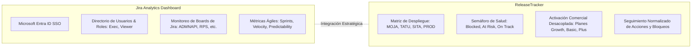
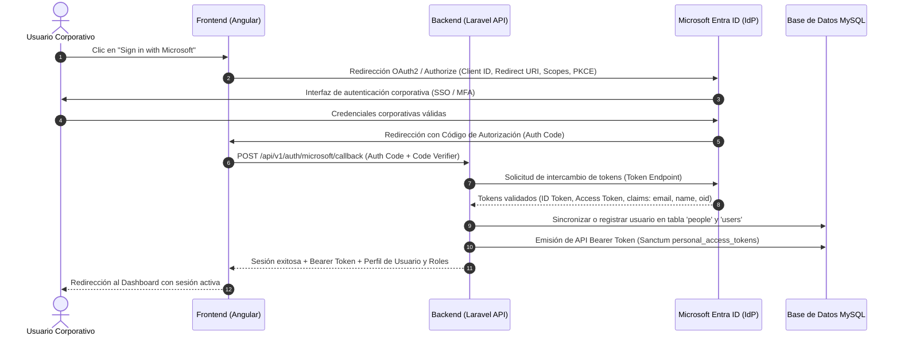
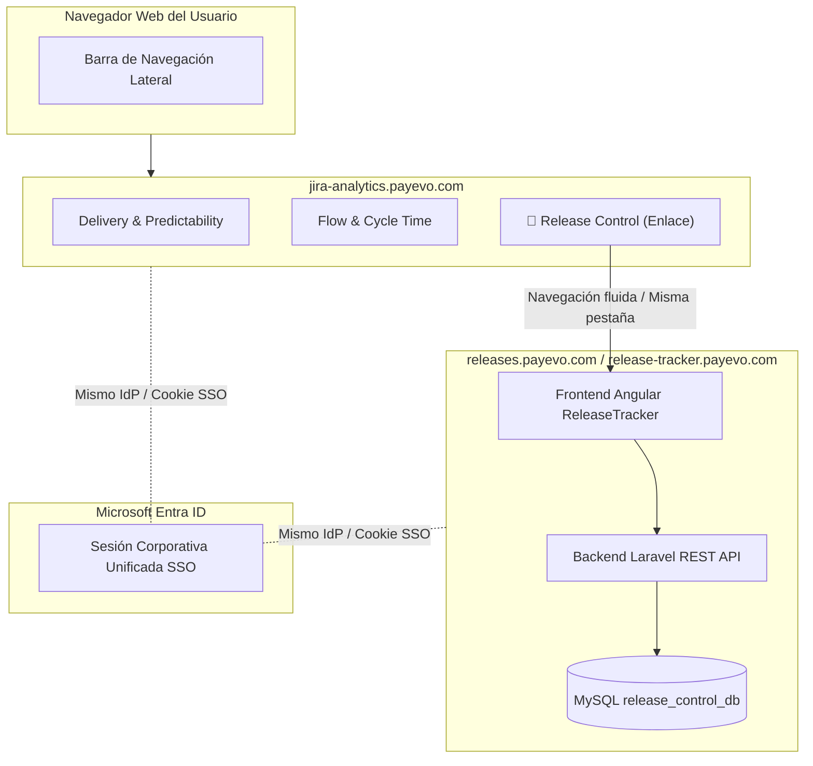
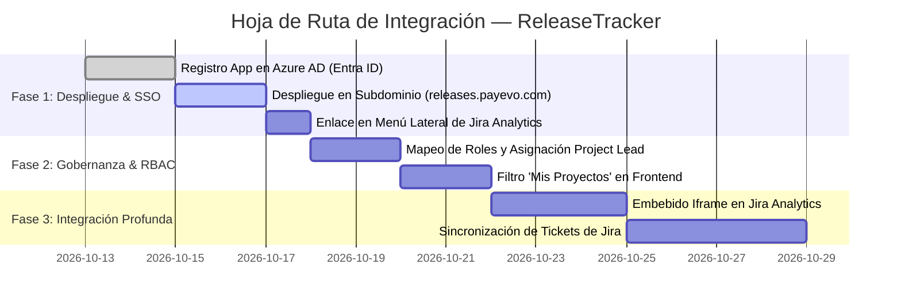

# Especificación Técnica — Integración, Autenticación Microsoft SSO y Gestión de Project Lead

**Producto:** ReleaseTracker (Project & Release Control)  
**Sistema anfitrión:** Jira Analytics Dashboard (`https://jira-analytics.payevo.com`)  
**Plataforma de identidad:** Microsoft Entra ID (Azure AD) — Dominio PaymentEvolution  
**Público objetivo:** Equipo de Ingeniería y Arquitectura de Software  

---

## 1. Introducción y Objetivos de la Arquitectura

El presente documento define las especificaciones técnicas y la arquitectura de integración para **ReleaseTracker**, estableciendo su articulación formal con la infraestructura de aplicaciones y la plataforma de identidad corporativa de PaymentEvolution.

### Objetivos Principales:
1. **Autenticación Corporativa Unificada (SSO):** Diseñar el flujo de inicio de sesión mediante credenciales de Microsoft Entra ID (Azure AD) para garantizar acceso seguro y unificado con cuentas `@paymentevolution.com` y `@corp.paymentevolution.com`.
2. **Modelo de Autorización y Gestión de *Project Lead*:** Formalizar la asignación y gobernanza de líderes de proyecto (*Project Leads*), vinculando la identidad del usuario autenticado con un esquema de control de acceso basado en roles (RBAC).
3. **Estrategia de Integración en Jira Analytics Dashboard:** Evaluar y especificar las alternativas técnicas para incorporar ReleaseTracker dentro de la suite de analítica de ingeniería existente en `https://jira-analytics.payevo.com`.
4. **Sinergia de Datos:** Aprovechar los tableros de Jira y la información de entregas para conectar el seguimiento ágil con la matriz de despliegue multiamiente y activación a clientes.
5. **Definición de Entregables de Transferencia:** Estructurar el paquete de documentación, código y base de datos para una implementación fluida por parte del equipo de ingeniería.

---

## 2. Contexto del Ecosistema de Plataformas

Dentro del entorno de ingeniería de PaymentEvolution coexisten dos capacidades complementarias:



* **Jira Analytics Dashboard (`https://jira-analytics.payevo.com`):**  
  Plataforma productiva orientada a la visibilidad del flujo de desarrollo y métricas de proceso (Sprints, Velocidad, Predictibilidad, Carryover, Tiempos de ciclo). Cuenta con autenticación corporativa Microsoft y administración de usuarios integrada.
* **ReleaseTracker:**  
  Plataforma especializada en la gobernanza y control físico de versiones. Proporciona seguimiento del pipeline de infraestructura (`MOJA` → `TATU` → `SITA` → `PROD`), gestión formal de aprobaciones (*Sign-offs* de QA y PO), activación comercial independiente para clientes y resolución de bloqueos operativos.

La integración de ambas herramientas proporciona visibilidad integral de extremo a extremo: desde el desarrollo ágil en sprints hasta el despliegue efectivo en producción y disponibilidad comercial.

---

## 3. Especificación Técnica de Autenticación: Microsoft SSO

### 3.1 Proveedor de Identidad y Alcance
La autenticación se delega en **Microsoft Entra ID (Azure AD)** de PaymentEvolution mediante el estándar **OAuth 2.0 / OpenID Connect (OIDC)**.

* **Tenant:** Directorio corporativo de PaymentEvolution.
* **Dominios de correo admitidos:**
  - `*@paymentevolution.com`
  - `*@corp.paymentevolution.com`
* **Criterio de Seguridad:** Acceso estrictamente restringido a cuentas organizacionales activas. Cualquier intento de inicio de sesión con cuentas personales o dominios ajenos será rechazado automáticamente en la validación del token.

### 3.2 Flujo de Autenticación (Authorization Code Flow with PKCE)

Para la arquitectura desacoplada de ReleaseTracker (Frontend Angular SPA + Backend Laravel REST API), se adopta el flujo de código de autorización con clave de prueba para intercambio de código (PKCE):



### 3.3 Permisos Requeridos (Microsoft Graph Scopes)
Se aplicará el principio de mínimo privilegio (*Least Privilege Principle*), solicitando únicamente permisos de lectura delegada:
* `openid`: Validación del estándar OIDC.
* `profile`: Acceso al nombre completo del usuario.
* `email`: Acceso al correo corporativo principal.
* `User.Read`: Consulta de metadatos básicos del perfil de usuario en Microsoft Graph.

### 3.4 Sincronización Automática con la Tabla `people`
Al autenticarse exitosamente un usuario:
1. El backend consulta la tabla [`people`](file:///c:/PROYECTOS/ReleaseControl_01/database/release_control_db_06.sql#L665) por coincidencia de `email`.
2. **Si el usuario existe:** Se actualiza `display_name` en caso de discrepancia y se asegura que `is_active = 1`.
3. **Si el usuario es nuevo:** Se crea automáticamente un registro en `people` asignando su nombre completo, correo corporativo, y estado activo.
4. Se registra el evento de inicio de sesión en la tabla inmutable [`audit_events`](file:///c:/PROYECTOS/ReleaseControl_01/database/release_control_db_06.sql#L57) con fines de trazabilidad y seguridad.

---

## 4. Especificación: Modelo de Project Lead y Control de Acceso (RBAC)

### 4.1 Entidad y Gobernanza del *Project Lead*
El **Project Lead** es el responsable técnico y operativo designado para coordinar el ciclo de vida, las versiones y las decisiones de despliegue de un proyecto específico.

En el modelo de datos de ReleaseTracker, esta relación está materializada directamente en:
```sql
projects.owner_person_id -> BIGINT UNSIGNED REFERENCES people(id)
```

### 4.2 Matriz de Roles y Permisos

Para mantener coherencia con el esquema de usuarios existente en Jira Analytics, se implementa el siguiente modelo de Control de Acceso Basado en Roles (RBAC):

| Rol | Criterio de Asignación | Alcance de Permisos en ReleaseTracker |
|---|---|---|
| **`Admin`** | Administradores globales designados en configuración | Control total del sistema: creación y edición de todos los proyectos, gestión de catálogos globales, configuración de ambientes y reasignación de Project Leads. |
| **`Exec` / `Project Lead`** | Usuario registrado como `projects.owner_person_id` | **Gestión Plena de su Proyecto:** Creación y edición de releases, registro de ítems, actualización de estados en la matriz de ambientes, asignación de follow-ups y confirmación de activaciones comerciales. |
| **`Viewer` / Colaborador** | Cuentas corporativas autenticadas sin asignación de liderazgo | **Lectura y Consulta:** Visualización completa de tableros, matrices de ambientes, filtros, métricas de salud y exportación de datos. Sin permisos de modificación. |

### 4.3 Reglas de Negocio de Autorización

1. **Elegibilidad:**
   * Solo los usuarios activos registrados en `people` con correo corporativo verificado pueden ser asignados como *Project Lead*.
   * La interfaz de administración restringe los selectores de líderes exclusivamente a registros con `is_active = 1`.
2. **Evaluación de Permisos en Tiempo de Ejecución:**
   * Al acceder a un proyecto, el backend y el frontend evalúan:
     ```php
     $isProjectLead = ($project->owner_person_id === $authenticatedUser->person_id);
     $isAdmin = $authenticatedUser->hasRole('admin');
     $canEdit = $isProjectLead || $isAdmin;
     ```
   * Si `$canEdit` es afirmativo, se habilitan las acciones de mutación (cambio de estados, creación de releases, edición de ítems). De lo contrario, la interfaz opera en modo analítico de solo lectura.
3. **Experiencia de Usuario ("Mis Proyectos" vs. "Todos los Proyectos"):**
   * El selector principal de proyectos en la cabecera del frontend incorpora un conmutador rápido:
     * **"Mis Proyectos" (`My Projects`):** Proyectos bajo el liderazgo directo del usuario conectado.
     * **"Todos los Proyectos" (`All Projects`):** Vista panorámica de todos los proyectos de ingeniería de la empresa.

---

## 5. Especificación: Alternativas de Integración en Jira Analytics Dashboard

Se evalúan tres alternativas técnicas para incorporar ReleaseTracker dentro de la infraestructura y navegación de Jira Analytics Dashboard:

---

### Alternativa 1: Despliegue en Subdominio con SSO Federado Compartido (*Hub & Spoke*)
> **Recomendación para Fase 1 — Implementación Rápida y de Bajo Riesgo**



#### Descripción:
* ReleaseTracker se despliega como servicio web independiente bajo un subdominio oficial (ej. `https://releases.payevo.com` o `https://release-tracker.payevo.com`).
* En la barra de menú lateral de Jira Analytics (junto a *Delivery & Predictability*, *Quality & Reliability*, etc.), se incorpora el ítem de navegación: **"Release Control"** o **"Release Tracker"**.
* Ambos portales comparten la misma configuración de Azure AD. Al haber iniciado sesión en Jira Analytics, el paso a ReleaseTracker es transparente e instantáneo sin requerir un nuevo inicio de sesión.

#### Ventajas:
* **Riesgo Cero para Jira Analytics:** No altera el código fuente, dependencias ni el proceso de compilación de Jira Analytics.
* **Despliegue Inmediato:** Permite poner la solución en producción rápidamente una vez configurado el DNS y la infraestructura.
* **Autonomía Operativa:** Los ciclos de mantenimiento y actualización de ReleaseTracker se ejecutan de manera totalmente independiente.

---

### Alternativa 2: Módulo Embebido mediante Iframe y Enlace de Token Seguro
> **Recomendación para Fase 2 — Experiencia de Usuario Totalmente Unificada**

#### Descripción:
* Dentro de Jira Analytics se habilita la sub-ruta interna: `https://jira-analytics.payevo.com/dashboard/releases`.
* La pantalla renderiza la interfaz de ReleaseTracker dentro de un contenedor `<iframe>` integrado en el diseño principal del portal.
* La aplicación anfitriona transmite de forma segura el token de sesión hacia ReleaseTracker mediante la API estándar de `window.postMessage`.

#### Ventajas:
* El usuario nunca percibe un cambio de sitio web; el menú lateral y la barra de navegación superior de Jira Analytics permanecen fijas.
* Reutiliza el 100% de la lógica y componentes desarrollados en Angular y Laravel.

#### Requerimientos de Seguridad:
* Configuración de la cabecera HTTP:
  ```http
  Content-Security-Policy: frame-ancestors 'self' https://jira-analytics.payevo.com;
  ```

---

### Alternativa 3: Fusión Nativa de Componentes Frontend (Micro-Frontend / API Directa)
> **Visión a Largo Plazo**

#### Descripción:
* El frontend de Jira Analytics incorpora directamente las vistas de ReleaseTracker como componentes nativos consumiendo la API REST de Laravel (`/api/v1/...`).

#### Ventajas:
* Consistencia visual absoluta e interacción bidireccional profunda entre métricas de sprints y matrices de ambientes.

#### Desventajas:
* Mayor esfuerzo de desarrollo e interdependencia de despliegues entre equipos.

---

### Tabla Comparativa de Alternativas

| Criterio | Alternativa 1: Subdominio + SSO | Alternativa 2: Embebido / Iframe | Alternativa 3: Fusión Nativa |
|---|:---:|:---:|:---:|
| **Tiempo de Despliegue** | ⚡ **Inmediato (1–2 días)** | 🟡 Corto (3–5 días) | 🔴 Extenso (2–3 semanas) |
| **Riesgo de Regresión** | 🟢 Nulo | 🟢 Muy bajo | 🟡 Medio |
| **Experiencia de Usuario** | 🟡 Transición de URL limpia | 🟢 100% Unificada | 🟢 100% Nativa |
| **Independencia de Despliegues** | 🟢 Total | 🟢 Total | 🔴 Acoplada |
| **Aprovechamiento de Código Actual** | 🟢 100% del desarrollo | 🟢 100% del desarrollo | 🟡 Solo backend |

> [!TIP]
> **Estrategia Recomendada:**  
> Adoptar la **Alternativa 1 (Subdominio con SSO)** como entrega inmediata para puesta en producción, dejando la arquitectura preparada para habilitar la **Alternativa 2 (Embebido)** con mínimo esfuerzo cuando se requiera consolidar la navegación en una única URL.

---

## 6. Sinergia e Integración de Datos con Jira

Jira Analytics Dashboard monitorea activamente proyectos organizacionales asociados a tableros clave:
`ADMNAPI`, `BB`, `BBB`, `DAS`, `FINTC`, `ONB`, `PWRUN`, `PR`, `RPS`.

En ReleaseTracker, la estructura de datos ya fue diseñada con compatibilidad nativa hacia esta nomenclatura:
* La tabla [`release_items`](file:///c:/PROYECTOS/ReleaseControl_01/database/release_control_db_06.sql#L832) contiene las columnas [`jira_key`](file:///c:/PROYECTOS/ReleaseControl_01/database/release_control_db_06.sql#L842) (ej. `RPS-298`) y [`jira_url`](file:///c:/PROYECTOS/ReleaseControl_01/database/release_control_db_06.sql#L843).
* Existe alineación directa entre los módulos del sistema y los tableros de Jira:
  - `ADMNAPI` ↔ Ítem `#4` *AdminAPI Improvements*
  - `PWRUN` ↔ Ítem `#2` *Payrun History Base Release*
  - `RPS` ↔ Ítems `#1` al `#9` *Reports*

### Oportunidades de Integración Funcional:
1. **Navegación Contextual:** Enlaces directos desde las métricas de sprint en Jira Analytics hacia el estado físico del artefacto en ReleaseTracker.
2. **Validación de Entrega Real:** Detección automática de discrepancias cuando un ticket marcado como *"Done"* en Jira aún no ha sido promovido a `PROD` o no ha sido activado comercialmente para clientes en ReleaseTracker.

---

## 7. Paquete de Transferencia Técnica y Hoja de Ruta

Para garantizar una transición técnica ordenada y facilitar el trabajo colaborativo con el equipo de ingeniería, se formaliza el siguiente paquete de transferencia:

### 7.1 Inventario de Entregables
1. **Especificaciones de Requisitos y Negocio:**
   * PRD v1.0 en Inglés ([PRD_Project_and_Release_Control_Local_MVP_v1.0_EN.md](file:///c:/PROYECTOS/ReleaseControl_01/Documents/PRD_Project_and_Release_Control_Local_MVP_v1.0_EN.md)).
   * PRD v1.0 en Español ([PRD_Project_and_Release_Control_Local_MVP_v1.0_ES.md](file:///c:/PROYECTOS/ReleaseControl_01/Documents/PRD_Project_and_Release_Control_Local_MVP_v1.0_ES.md)).
2. **Especificaciones de Arquitectura y Base de Datos:**
   * Diseño de Base de Datos v1.0 en Inglés ([Database_Design_Project_Release_Control_Local_MVP_v1.0_EN.md](file:///c:/PROYECTOS/ReleaseControl_01/Documents/Database_Design_Project_Release_Control_Local_MVP_v1.0_EN.md)).
   * Diseño de Base de Datos v1.0 en Español ([Database_Design_Project_Release_Control_Local_MVP_v1.0_ES.md](file:///c:/PROYECTOS/ReleaseControl_01/Documents/Database_Design_Project_Release_Control_Local_MVP_v1.0_ES.md)).
   * La presente Especificación Técnica de Integración, SSO y Project Lead.
3. **Línea Base de Base de Datos:**
   * Dump SQL completo y verificado: [`database/release_control_db_06.sql`](file:///c:/PROYECTOS/ReleaseControl_01/database/release_control_db_06.sql).
4. **Código Fuente del Repositorio:**
   * Backend en Laravel 10 con 17 migraciones ordenadas, seeders y API REST.
   * Frontend en Angular con matriz multiamiente interactiva, persistencia de filtros en combos y motor de salud en vivo.

### 7.2 Hoja de Ruta de Implementación Propuesta



Este esquema provee una arquitectura sólida, documentada y desacoplada, asegurando que la plataforma esté lista para entrar en fase de integración corporativa.
