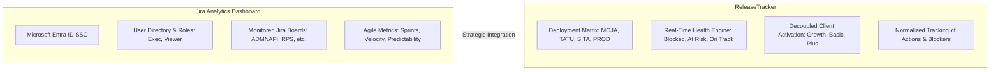
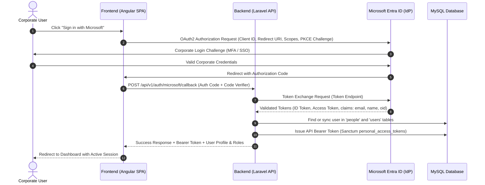
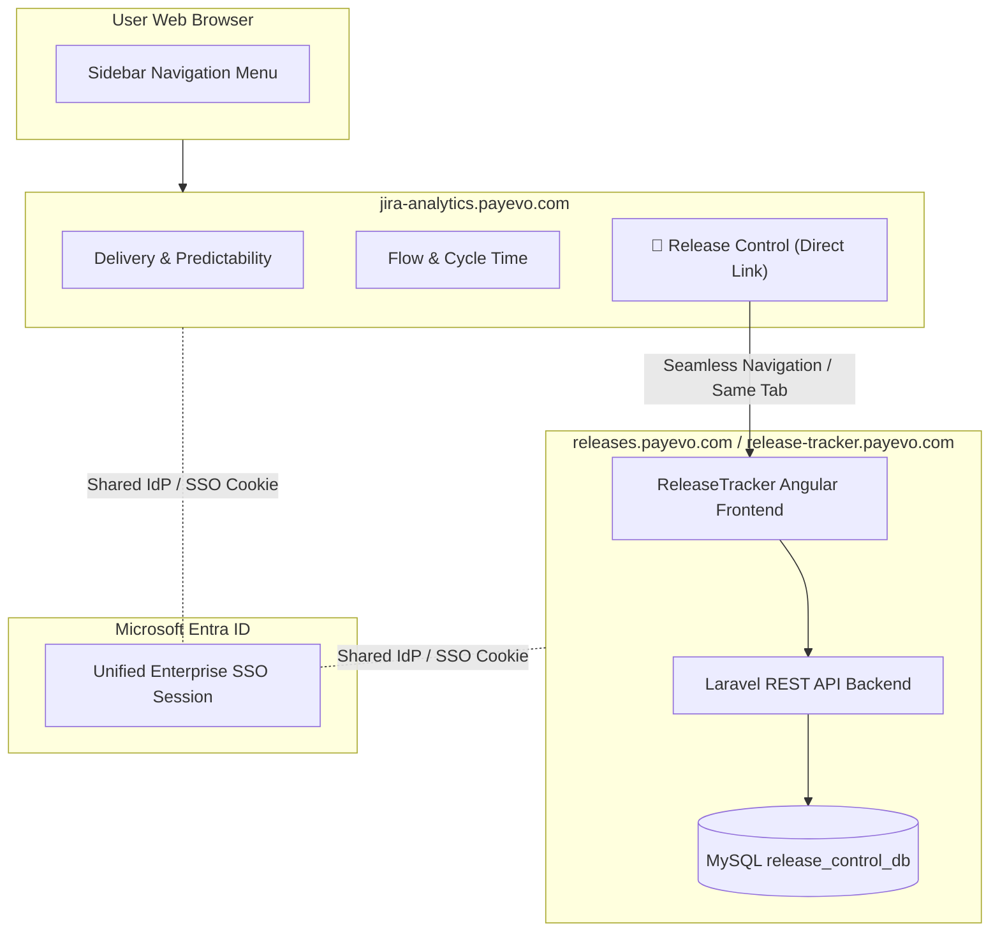
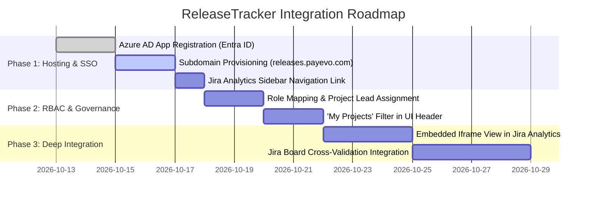

# Technical Specification — Integration, Microsoft SSO Authentication, and Project Lead Management

**Product:** ReleaseTracker (Project & Release Control)  
**Host System:** Jira Analytics Dashboard (`https://jira-analytics.payevo.com`)  
**Identity Platform:** Microsoft Entra ID (Azure AD) — PaymentEvolution Domain  
**Target Audience:** Software Engineering & Architecture Team  

---

## 1. Introduction & Architectural Objectives

This document establishes the technical specifications and integration architecture for **ReleaseTracker**, formalizing its interoperability with PaymentEvolution's enterprise application ecosystem and corporate identity infrastructure.

### Core Objectives:
1. **Unified Enterprise Single Sign-On (SSO):** Design the authentication flow leveraging Microsoft Entra ID (Azure AD) to ensure secure, unified access for `@paymentevolution.com` and `@corp.paymentevolution.com` organizational accounts.
2. **Authorization Model & Project Lead Governance:** Formalize the assignment and permission model for *Project Leads*, establishing a deterministic Role-Based Access Control (RBAC) mechanism linked to the authenticated user.
3. **Integration Strategy within Jira Analytics Dashboard:** Evaluate and specify technical alternatives to incorporate ReleaseTracker into the active engineering analytics suite at `https://jira-analytics.payevo.com`.
4. **Data Synergy & Cross-Platform Alignment:** Leverage existing Jira board configurations and delivery metrics to bridge agile sprint tracking with multi-environment deployment matrices and commercial client activation.
5. **Technical Hand-off Definition:** Structure a comprehensive package of documentation, codebase, and database baselines for seamless team adoption and execution.

---

## 2. Platform Ecosystem Overview

Within PaymentEvolution's engineering environment, two complementary systems operate in synergy:



* **Jira Analytics Dashboard (`https://jira-analytics.payevo.com`):**  
  Production platform focused on engineering flow visibility and process metrics (Sprints, Velocity, Predictability, Carryover, Cycle Times). It currently features Microsoft enterprise authentication and an active user administration directory.
* **ReleaseTracker:**  
  Specialized platform focused on software governance and release pipeline control. It tracks physical artifact progression across environments (`MOJA` → `TATU` → `SITA` → `PROD`), formal approval gates (*QA and PO Sign-offs*), decoupled commercial client activation by subscription tiers, and operational blocker resolution.

Integrating both platforms provides end-to-end visibility: connecting sprint planning and ticket completion directly to infrastructure rollout and client availability.

---

## 3. Microsoft SSO Authentication Technical Specification

### 3.1 Identity Provider & Scope
Authentication is federated to PaymentEvolution's **Microsoft Entra ID (Azure AD)** tenant utilizing the **OAuth 2.0 / OpenID Connect (OIDC)** standard.

* **Tenant:** PaymentEvolution corporate directory.
* **Authorized Email Domains:**
  - `*@paymentevolution.com`
  - `*@corp.paymentevolution.com`
* **Security Constraint:** Access is strictly restricted to active organizational accounts. Any authentication attempt from personal Microsoft accounts or unauthorized domains is automatically denied during token verification.

### 3.2 Authentication Flow (Authorization Code Flow with PKCE)

Given ReleaseTracker's decoupled architecture (Angular SPA Frontend + Laravel REST API Backend), the Authorization Code Flow with Proof Key for Code Exchange (PKCE) is implemented:



### 3.3 Required Microsoft Graph Scopes
Following the Principle of Least Privilege, only essential delegated read permissions are requested:
* `openid`: OIDC token validation.
* `profile`: User's full display name.
* `email`: Primary corporate email address.
* `User.Read`: Basic profile metadata retrieval from Microsoft Graph.

### 3.4 Automatic User Synchronization with the `people` Table
Upon successful authentication:
1. The backend inspects the [`people`](file:///c:/PROYECTOS/ReleaseControl_01/database/release_control_db_06.sql#L665) table by matching `email`.
2. **Existing User:** Updates `display_name` if modified in Entra ID and ensures `is_active = 1`.
3. **New User:** Automatically provisions a row in `people` storing display name, corporate email, and active status.
4. Logs the authentication event in the immutable [`audit_events`](file:///c:/PROYECTOS/ReleaseControl_01/database/release_control_db_06.sql#L57) table for auditability and compliance.

---

## 4. Project Lead Model & Access Control Specification (RBAC)

### 4.1 Definition and Role of the *Project Lead*
The **Project Lead** is the designated engineering lead accountable for coordinating the lifecycle, release planning, and deployment approvals for a specific project.

In ReleaseTracker's schema, this relationship is explicitly materialized as:
```sql
projects.owner_person_id -> BIGINT UNSIGNED REFERENCES people(id)
```

### 4.2 Role-Based Access Control (RBAC) Matrix

To preserve alignment with the user administration structure in Jira Analytics, the following permission model is established:

| Role | Assignment Criteria | ReleaseTracker Permissions Scope |
|---|---|---|
| **`Admin`** | System administrators defined in platform configuration | Full system control: create/edit all projects, manage global catalogs, configure environments, and reassign Project Leads. |
| **`Exec` / `Project Lead`** | User mapped as `projects.owner_person_id` | **Full Project Management:** Create and edit releases, register items, update environment states in the matrix, assign follow-ups, and confirm client activations for their project. |
| **`Viewer` / Collaborator** | Authenticated corporate users without lead designation | **Read-Only Analytics:** View dashboards, environment matrices, filters, health status, and export reports. Mutation actions are disabled. |

### 4.3 Authorization Business Rules

1. **Eligibility:**
   * Only active users in `people` with verified corporate emails may be assigned as *Project Lead*.
   * Project configuration dropdowns strictly filter options to records where `is_active = 1`.
2. **Runtime Permission Evaluation:**
   * Upon accessing a project, the system validates:
     ```php
     $isProjectLead = ($project->owner_person_id === $authenticatedUser->person_id);
     $isAdmin = $authenticatedUser->hasRole('admin');
     $canEdit = $isProjectLead || $isAdmin;
     ```
   * If `$canEdit` is true, write operations (matrix status toggles, release creation, item updates) are unlocked. Otherwise, the interface renders in read-only mode.
3. **User Experience ("My Projects" vs. "All Projects"):**
   * The project selector in the application header provides an instant view toggle:
     * **"My Projects":** Projects led directly by the logged-in user.
     * **"All Projects":** Complete engineering project inventory across the organization.

---

## 5. Integration Alternatives in Jira Analytics Dashboard

Three technical alternatives are evaluated for integrating ReleaseTracker into Jira Analytics Dashboard:

---

### Alternative 1: Subdomain Deployment with Shared Federated SSO (*Hub & Spoke*)
> **Recommended for Phase 1 — Rapid & Zero-Risk Delivery**



#### Description:
* ReleaseTracker is hosted under a dedicated corporate subdomain (e.g., `https://releases.payevo.com` or `https://release-tracker.payevo.com`).
* Inside Jira Analytics' sidebar navigation menu, a new item is added: **"Release Control"** or **"Release Tracker"**.
* Both web applications share the same Azure AD configuration. A user authenticated in Jira Analytics transitions to ReleaseTracker seamlessly without re-authenticating.

#### Advantages:
* **Zero Regression Risk:** Requires zero changes to Jira Analytics' internal source code, dependencies, or build pipelines.
* **Immediate Deployment:** Operational within 1–2 days once DNS records and hosting infrastructure are configured.
* **Operational Independence:** ReleaseTracker can be upgraded, deployed, or scaled without coupling to Jira Analytics release cycles.

---

### Alternative 2: Embedded Module via Secure Iframe & Token Bridge
> **Recommended for Phase 2 — Fully Unified User Interface**

#### Description:
* Inside Jira Analytics, a dedicated sub-route is established: `https://jira-analytics.payevo.com/dashboard/releases`.
* The view embeds ReleaseTracker inside a responsive `<iframe>` container styled to match the dashboard layout.
* The host dashboard transmits the authentication token to ReleaseTracker via the standard, secure `window.postMessage` API.

#### Advantages:
* The user never leaves the primary portal URL; Jira Analytics navigation remains persistently visible.
* Retains 100% of ReleaseTracker's existing Angular components and Laravel API logic.

#### Security Requirements:
* Proper HTTP header configuration:
  ```http
  Content-Security-Policy: frame-ancestors 'self' https://jira-analytics.payevo.com;
  ```

---

### Alternative 3: Native Frontend Component Merge (Micro-Frontend / Direct API)
> **Long-Term Vision**

#### Description:
* Jira Analytics' frontend directly incorporates ReleaseTracker views as native components, consuming ReleaseTracker's Laravel REST API (`/api/v1/...`).

#### Advantages:
* Flawless visual consistency and deep bidirectional interactions between sprint charts and deployment matrices.

#### Trade-offs:
* High engineering investment and deployment coupling across development teams.

---

### Comparative Evaluation Matrix

| Criterion | Alternative 1: Subdomain + SSO | Alternative 2: Embedded / Iframe | Alternative 3: Native Merge |
|---|:---:|:---:|:---:|
| **Deployment Time** | ⚡ **Immediate (1–2 days)** | 🟡 Short (3–5 days) | 🔴 Long (2–3 weeks) |
| **Regression Risk** | 🟢 Zero | 🟢 Very Low | 🟡 Medium |
| **User Experience** | 🟡 Clean URL Transition | 🟢 100% Unified | 🟢 100% Native |
| **Release Independence** | 🟢 Full | 🟢 Full | 🔴 Coupled |
| **Codebase Reusability** | 🟢 100% Existing Code | 🟢 100% Existing Code | 🟡 Backend Only |

> [!TIP]
> **Recommended Roadmap:**  
> Implement **Alternative 1 (Subdomain with Shared SSO)** for immediate production readiness, structuring the styling and communication channels so **Alternative 2 (Embedded View)** can be enabled with minimal effort when URL unification is prioritized.

---

## 6. Data Synergy & Integration with Jira

Jira Analytics Dashboard currently monitors key organizational projects associated with active boards:
`ADMNAPI`, `BB`, `BBB`, `DAS`, `FINTC`, `ONB`, `PWRUN`, `PR`, `RPS`.

ReleaseTracker's schema was architected with native compatibility for this nomenclature:
* The [`release_items`](file:///c:/PROYECTOS/ReleaseControl_01/database/release_control_db_06.sql#L832) table includes [`jira_key`](file:///c:/PROYECTOS/ReleaseControl_01/database/release_control_db_06.sql#L842) (e.g., `RPS-298`) and [`jira_url`](file:///c:/PROYECTOS/ReleaseControl_01/database/release_control_db_06.sql#L843).
* Direct alignment exists across project modules and Jira board identifiers:
  - `ADMNAPI` ↔ Item `#4` *AdminAPI Improvements*
  - `PWRUN` ↔ Item `#2` *Payrun History Base Release*
  - `RPS` ↔ Items `#1` through `#9` *Reports*

### Integration Opportunities:
1. **Contextual Deep Linking:** Direct links from sprint velocity charts in Jira Analytics to the physical environment promotion status in ReleaseTracker.
2. **True Delivery Verification:** Automated cross-validation flagging when a Jira issue marked *"Done"* has not reached `PROD` or remains unconfirmed for client activation in ReleaseTracker.

---

## 7. Technical Hand-off Package & Implementation Roadmap

To facilitate engineering adoption and implementation, the following technical package is established:

### 7.1 Hand-off Artifact Inventory
1. **Requirements & Scope Documentation:**
   * PRD v1.0 English ([PRD_Project_and_Release_Control_Local_MVP_v1.0_EN.md](file:///c:/PROYECTOS/ReleaseControl_01/Documents/PRD_Project_and_Release_Control_Local_MVP_v1.0_EN.md)).
   * PRD v1.0 Spanish ([PRD_Project_and_Release_Control_Local_MVP_v1.0_ES.md](file:///c:/PROYECTOS/ReleaseControl_01/Documents/PRD_Project_and_Release_Control_Local_MVP_v1.0_ES.md)).
2. **Architecture & Database Design:**
   * Database Design v1.0 English ([Database_Design_Project_Release_Control_Local_MVP_v1.0_EN.md](file:///c:/PROYECTOS/ReleaseControl_01/Documents/Database_Design_Project_Release_Control_Local_MVP_v1.0_EN.md)).
   * Database Design v1.0 Spanish ([Database_Design_Project_Release_Control_Local_MVP_v1.0_ES.md](file:///c:/PROYECTOS/ReleaseControl_01/Documents/Database_Design_Project_Release_Control_Local_MVP_v1.0_ES.md)).
   * Technical Specification in Spanish ([Especificacion_Tecnica_Integracion_SSO_ReleaseTracker_ES.md](file:///c:/PROYECTOS/ReleaseControl_01/Documents/Especificacion_Tecnica_Integracion_SSO_ReleaseTracker_ES.md)).
   * Technical Specification in English (This document).
3. **Verified Database Snapshot:**
   * Complete, tested MySQL baseline dump: [`database/release_control_db_06.sql`](file:///c:/PROYECTOS/ReleaseControl_01/database/release_control_db_06.sql).
4. **Application Codebase:**
   * Backend in Laravel 10 with 17 migrations, seeders, and REST API controllers.
   * Frontend in Angular with multi-environment interactive matrix, persistent dropdown state, and dynamic health engine.

### 7.2 Proposed Implementation Roadmap



This specification provides a robust, decoupled, and production-ready architectural foundation, ready for immediate review and implementation by the engineering team.
