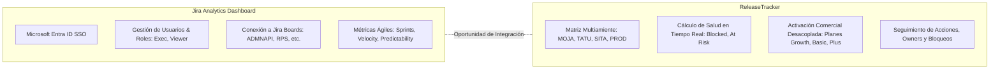
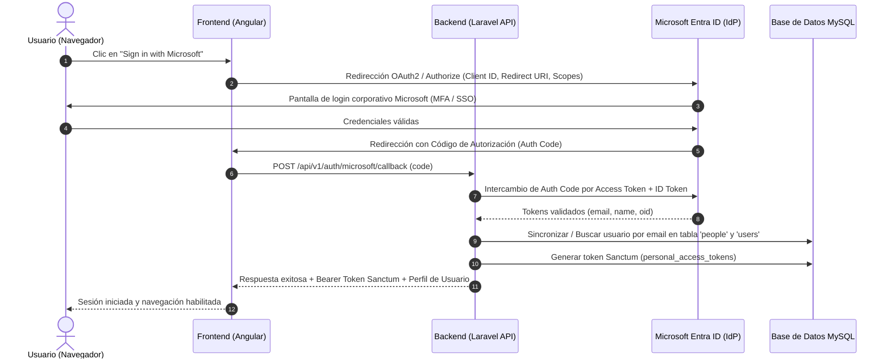
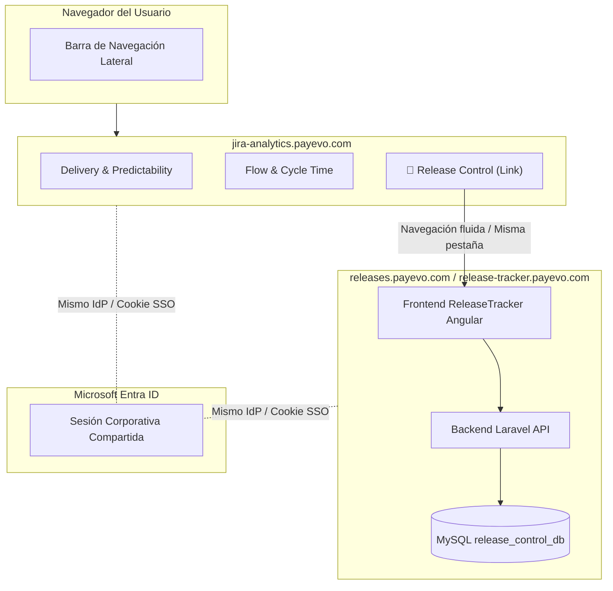

# Especificación Técnica — Integración, Autenticación Microsoft SSO y Asignación de Project Lead

**Producto:** ReleaseTracker (Project & Release Control)  
**Sistema de destino:** Jira Analytics Dashboard (`https://jira-analytics.payevo.com`)  
**Plataforma de identidad:** Microsoft Entra ID (Azure AD) — Dominio PaymentEvolution  
**Audiencia técnica:** Ameet Mehta, Yarhoslav Muñoz, Luis Herrera Paitan, Jhon Orellana  

---

## 1. Introducción y Propósito

El presente documento formaliza las especificaciones técnicas requeridas para la evolución e integración de **ReleaseTracker**, en cumplimiento de los acuerdos derivados de la reunión con Ameet Mehta:

* **Compromiso #3:** Elaborar la especificación para permitir el inicio de sesión (*login*) mediante credenciales Microsoft corporativas de PaymentEvolution.
* **Compromiso #4:** Elaborar la especificación para asignar un *Project Lead* a cada proyecto, definiendo su relación con el usuario autenticado y su modelo de permisos.
* **Compromiso #5:** Documentar y evaluar las alternativas arquitectónicas de integración de ReleaseTracker dentro de la plataforma **Jira Analytics Dashboard**.
* **Compromiso #6:** Establecer la base técnica para la coordinación y evaluación conjunta con **Yarhoslav Muñoz (Yarhos)** y **Luis Herrera Paitan**.

> [!NOTE]
> **Alcance de Entrega Inmediata:**  
> Conforme a la aclaración de Ameet, este entregable constituye la **especificación técnica formal de arquitectura y diseño**. El propósito es dejar una definición técnica completa, transferible y validada antes del periodo de vacaciones, permitiendo al equipo evaluar o continuar la implementación de forma autónoma.

---

## 2. Contexto del Ecosistema de Aplicaciones

Actualmente conviven dos sistemas complementarios dentro del área de ingeniería de PaymentEvolution:



1. **Jira Analytics Dashboard (`https://jira-analytics.payevo.com`):**
   * Aplicación corporativa en producción orientada a la visibilidad de entrega y flujo ágil (Sprints, Velocidad, Predictibilidad, Carryover, Cycle Time).
   * Ya cuenta con autenticación federada mediante **Microsoft SSO** (cuentas `@paymentevolution.com` y `@corp.paymentevolution.com`).
   * Ya dispone de un módulo de administración con directorio de usuarios, roles (`Exec`, `Viewer`) y vinculación a identidades de Jira.
2. **ReleaseTracker:**
   * Sistema especializado en el **control de despliegues y lanzamientos**.
   * Resuelve el vacío que Jira no cubre: el estado físico de artefactos a través del pipeline de infraestructura (`MOJA` → `TATU` → `SITA` → `PROD`), el control de sign-offs (QA y PO), la activación comercial desacoplada por planes y la resolución de bloqueos operativos.

---

## 3. Especificación de Autenticación: Microsoft SSO (Compromiso #3)

### 3.1 Arquitectura de Identidad Corporativa
La autenticación de ReleaseTracker se integrará con el tenant de **Microsoft Entra ID (Azure AD)** de PaymentEvolution mediante el protocolo **OAuth 2.0 / OpenID Connect (OIDC)**.

* **Tenant ID:** Directorio corporativo de PaymentEvolution.
* **Dominios de correo autorizados:**
  - `*@paymentevolution.com`
  - `*@corp.paymentevolution.com`
* **Restricción de acceso:** Se denegará el acceso a cualquier cuenta externa o personal de Microsoft.

### 3.2 Flujo de Autenticación Recomendado

Se especifica el flujo de código de autorización con PKCE (*Authorization Code Flow with PKCE*), compatible con la arquitectura actual de ReleaseTracker (Frontend Angular SPA + Backend Laravel REST API):



### 3.3 Scopes Requeridos de Microsoft Graph
Para la operación estándar de ReleaseTracker solo se requieren permisos de lectura básicos sin privilegios administrativos:
* `openid`: Identificación conforme a OIDC.
* `profile`: Lectura del nombre visible del usuario (`displayName`).
* `email`: Correo electrónico corporativo principal.
* `User.Read`: Lectura del perfil básico en Microsoft Graph.

### 3.4 Sincronización Automática con la Tabla `people`
Al autenticarse por primera vez un usuario con su correo de PaymentEvolution:
1. El backend consulta si el `email` existe en la tabla [`people`](file:///c:/PROYECTOS/ReleaseControl_01/database/release_control_db_06.sql#L665).
2. **Si existe:** Se actualiza `display_name` si hubo cambios en Microsoft Entra ID y se vincula la sesión.
3. **Si no existe:** Se crea automáticamente un registro en `people` con:
   * `display_name`: Nombre proveniente de Microsoft.
   * `email`: Correo corporativo autenticado.
   * `is_active`: `1` (activo).
4. Se registra el evento de inicio de sesión en [`audit_events`](file:///c:/PROYECTOS/ReleaseControl_01/database/release_control_db_06.sql#L57).

---

## 4. Especificación: Asignación de Project Lead y Relación con el Usuario Autenticado (Compromiso #4)

### 4.1 Definición y Rol del *Project Lead*
El **Project Lead** (Líder de Proyecto) es la persona responsable del ciclo de vida, alcance y entregas de un proyecto de ingeniería en ReleaseTracker.

En la base de datos de ReleaseTracker, esta figura ya está estructurada a través de la columna:
```sql
projects.owner_person_id -> BIGINT UNSIGNED REFERENCES people(id)
```

### 4.2 Matriz de Roles y Niveles de Permiso (RBAC)

Para mantener total coherencia con los roles observados en la administración de *Jira Analytics Dashboard*, se define el siguiente modelo:

| Rol en el Sistema | Origen del Rol | Alcance de Permisos en ReleaseTracker |
|---|---|---|
| **`Admin`** | Asignado en administración (ej. Jhon, Ameet, Yarhos) | Control total: Crear/editar cualquier proyecto, modificar catálogos, reasignar Project Leads, configurar ambientes. |
| **`Exec` / `Project Lead`** | Usuario asignado en `projects.owner_person_id` | **Gestión de su Proyecto:** Crear y editar releases, agregar/modificar release items, actualizar estados de ambiente, asignar follow-ups y confirmar activaciones de su proyecto. |
| **`Viewer` / Colaborador** | Cuentas corporativas autenticadas por defecto | **Solo Lectura:** Visualizar dashboard, matriz de ambientes, filtros y exportación. No puede alterar estados ni configuraciones. |

### 4.3 Reglas de Negocio para la Asignación de Project Lead

1. **Elegibilidad:**
   * Un Project Lead debe ser obligatoriamente un usuario activo registrado en `people` con correo corporativo verificado.
   * La lista desplegable en la configuración del proyecto solo mostrará usuarios con `is_active = 1`.
2. **Relación con el Usuario Autenticado:**
   * Cuando un usuario autenticado ingresa a la aplicación, el sistema evalúa:
     ```php
     $isProjectLead = ($project->owner_person_id === $authenticatedUser->person_id);
     $isAdmin = $authenticatedUser->hasRole('admin');
     ```
   * Si `$isProjectLead || $isAdmin` es verdadero, se habilitan las acciones de edición (botones de cambio de estado en la matriz, creación de releases, asignación de responsables).
   * Si es falso, el usuario visualiza el proyecto en modo **lectura analítica**.
3. **Vistas Personalizadas ("Mis Proyectos"):**
   * El selector principal de proyectos en el frontend incluirá una pestaña o filtro rápido:
     * **"Mis Proyectos" (`My Projects`):** Proyectos donde `owner_person_id == current_user_id`.
     * **"Todos los Proyectos" (`All Projects`):** Catálogo completo de proyectos disponibles.

---

## 5. Especificación: Alternativas de Integración en Jira Analytics Dashboard (Compromiso #5)

A partir del análisis de la estructura y navegación de *Jira Analytics Dashboard* (`https://jira-analytics.payevo.com`), se evalúan tres alternativas técnicas de integración:

---

### Alternativa A: Integración por Subdominio y SSO Federado (Enfoque *Hub & Spoke*) — **Recomendada para Fase 1**



#### Descripción:
* ReleaseTracker se despliega como un servicio web independiente bajo el subdominio corporativo oficial (ej. `https://releases.payevo.com` o `https://release-tracker.payevo.com`).
* En la barra de menú lateral de Jira Analytics (donde figuran *Delivery & Predictability*, *Quality & Reliability*, etc.), se agrega un nuevo ítem: **"Release Tracker"** o **"Release Control"**.
* Ambos sistemas comparten la misma configuración de Azure AD. Al haber iniciado sesión en Jira Analytics, el usuario pasa a ReleaseTracker de forma transparente mediante SSO sin necesidad de volver a autenticarse.

#### Ventajas:
* **Cero riesgo de regresión:** No modifica el código fuente interno ni el despliegue del Jira Analytics Dashboard actual.
* **Independencia tecnológica:** ReleaseTracker mantiene su stack actual (Laravel 10 + Angular + MySQL) sin forzar reescrituras.
* **Implementación inmediata:** Requiere únicamente dar de alta el registro DNS, el despliegue del contenedor/servidor y agregar el enlace en el menú lateral.

#### Desventajas:
* La barra de navegación superior y el encabezado se renderizan en la aplicación de ReleaseTracker (requiere ajustar estilos CSS para mimetizar la paleta de colores oscura de Jira Analytics).

---

### Alternativa B: Integración como Módulo Embebido mediante Iframe y *Token Bridge* — **Recomendada para Fase 2**

#### Descripción:
* Dentro de Jira Analytics se crea una ruta interna: `https://jira-analytics.payevo.com/dashboard/releases`.
* Esta vista carga ReleaseTracker dentro de un contenedor `<iframe>` integrado en el diseño principal del dashboard.
* La aplicación contenedora transmite el token de autenticación mediante `window.postMessage` de forma segura.

#### Ventajas:
* Experiencia de usuario completamente integrada: el menú lateral y la barra superior de Jira Analytics se mantienen visibles permanentemente.
* No requiere reescribir la lógica ni los componentes de Angular ni la API de Laravel.

#### Consideraciones Técnicas:
* Debe configurarse adecuadamente la cabecera `Content-Security-Policy: frame-ancestors 'self' https://jira-analytics.payevo.com` para permitir el embebido seguro y prevenir ataques de *clickjacking*.

---

### Alternativa C: Integración Nativa de Componentes (Micro-Frontend / API Directa) — **Visión a Largo Plazo**

#### Descripción:
* El frontend de Jira Analytics incorpora directamente las pantallas de ReleaseTracker como componentes nativos consumiendo la API REST de Laravel (`/api/v1/...`).
* Los datos de la matriz de ambientes y estados se consultan directamente desde el backend de ReleaseTracker.

#### Ventajas:
* Consistencia visual absoluta e integración bidireccional profunda (ej. vincular directamente las tarjetas de Sprint de Jira Analytics con las filas de la matriz de ReleaseTracker).

#### Desventajas:
* Mayor esfuerzo de desarrollo e interdependencia de código entre ambos equipos.

---

### Tabla Comparativa de Alternativas

| Criterio | Alternativa A: Subdominio + SSO | Alternativa B: Embebido / Iframe | Alternativa C: Componentes Nativos |
|---|:---:|:---:|:---:|
| **Tiempo de Entrega** | ⚡ **Rápido (1–2 días)** | 🟡 Moderado (3–5 días) | 🔴 Alto (2–3 semanas) |
| **Riesgo para Jira Analytics** | 🟢 Nulo | 🟢 Muy bajo | 🟡 Medio |
| **Experiencia de Usuario** | 🟡 Transición de URL | 🟢 100% Unificada | 🟢 100% Nativa |
| **Independencia de Despliegues** | 🟢 Total | 🟢 Total | 🔴 Acoplado |
| **Reutilización de Código Actual**| 🟢 100% del código existente | 🟢 100% del código existente | 🟡 Solo backend |

> [!TIP]
> **Recomendación Estratégica:**  
> Adoptar la **Alternativa A (Subdominio con SSO compartido)** como hito inmediato. Permite disponibilizar la herramienta en producción de inmediato sin tocar la base de código de Jira Analytics, dejando planteada la transición a la **Alternativa B** según el feedback de Yarhos y Ameet.

---

## 6. Sinergia de Datos entre Jira y ReleaseTracker

La pantalla de *Delivery & Predictability* de Jira Analytics (Imagen 4) muestra que el dashboard monitorea activamente tableros de Jira identificados por prefijos:
`ADMNAPI`, `BB`, `BBB`, `DAS`, `FINTC`, `ONB`, `PWRUN`, `PR`, `RPS`.

En la base de datos de ReleaseTracker:
* La tabla [`release_items`](file:///c:/PROYECTOS/ReleaseControl_01/database/release_control_db_06.sql#L832) ya cuenta con las columnas [`jira_key`](file:///c:/PROYECTOS/ReleaseControl_01/database/release_control_db_06.sql#L842) (ej. `RPS-298`) y [`jira_url`](file:///c:/PROYECTOS/ReleaseControl_01/database/release_control_db_06.sql#L843).
* Existe total coherencia entre los boards monitoreados en Jira Analytics y los ítems de ReleaseTracker (ej. `ADMNAPI` corresponde al ítem `#4` *AdminAPI Improvements*, `PWRUN` corresponde a *Payrun History*, `RPS` corresponde a *Reports*).

Esta coincidencia permite en el futuro:
1. Navegación directa desde Jira Analytics hacia el estado de despliegue en ambientes de ese ticket en ReleaseTracker.
2. Detección automática en Jira Analytics si un ticket completado en sprint se encuentra realmente promovido a `PROD` y si está activo para clientes.

---

## 7. Plan de Transferencia y Coordinación con Yarhos y Luis (Compromiso #6)

Para facilitar la evaluación técnica y el traspaso ordenado, se define el siguiente paquete de entrega (*Hand-off Package*):

### 7.1 Componentes a Facilitar
1. **Documentación Funcional y de Arquitectura:**
   * PRD v1.0 ([EN](file:///c:/PROYECTOS/ReleaseControl_01/Documents/PRD_Project_and_Release_Control_Local_MVP_v1.0_EN.md) / [ES](file:///c:/PROYECTOS/ReleaseControl_01/Documents/PRD_Project_and_Release_Control_Local_MVP_v1.0_ES.md)).
   * Diseño de Base de Datos v1.0 ([EN](file:///c:/PROYECTOS/ReleaseControl_01/Documents/Database_Design_Project_Release_Control_Local_MVP_v1.0_EN.md) / [ES](file:///c:/PROYECTOS/ReleaseControl_01/Documents/Database_Design_Project_Release_Control_Local_MVP_v1.0_ES.md)).
   * La presente Especificación Técnica de Integración y SSO.
2. **Repositorio de Código Fuente:**
   * Backend: Laravel 10 con 17 migraciones, seeders y API REST probada.
   * Frontend: Angular con interfaz moderna, soporte multiamiente, persistencia de filtros en combos y visualización de salud en tiempo real.
3. **Línea Base de Datos:**
   * Archivo SQL dump [`database/release_control_db_06.sql`](file:///c:/PROYECTOS/ReleaseControl_01/database/release_control_db_06.sql) listo para restauración inmediata en MySQL o MariaDB.

### 7.2 Puntos de Consulta para la Sesión Técnica con Yarhos
* **Punto 1:** Confirmar si el registro de aplicación de Azure AD utilizado por `jira-analytics.payevo.com` puede compartir sus credenciales (*Client ID* y *Tenant ID*) o si conviene registrar una aplicación dedicada para ReleaseTracker dentro del mismo tenant.
* **Punto 2:** Evaluar si prefieren desplegar ReleaseTracker en un subdominio independiente (*Alternativa A*) o preparar la vista para embebido interno (*Alternativa B*).
* **Punto 3:** Revisar si el servicio de base de datos MySQL puede compartirse con el servidor actual de Jira Analytics o mantenerse en una instancia separada.

---

## 8. Resumen de Entregables del Objetivo de Trabajo (Compromiso #7)

Con la formulación de estas especificaciones, el objetivo de trabajo de ReleaseTracker queda respaldado por los siguientes entregables verificables:

```
📦 Paquete de Entregables — ReleaseTracker v1.0
├── 📄 PRD_Project_and_Release_Control_Local_MVP_v1.0_EN.md (Requisitos y Alcance en Inglés)
├── 📄 PRD_Project_and_Release_Control_Local_MVP_v1.0_ES.md (Requisitos y Alcance en Español)
├── 📄 Database_Design_Project_Release_Control_Local_MVP_v1.0_EN.md (Diseño BD en Inglés)
├── 📄 Database_Design_Project_Release_Control_Local_MVP_v1.0_ES.md (Diseño BD en Español)
├── 📄 Especificacion_Tecnica_Integracion_SSO_ReleaseTracker_ES.md (Integración, SSO y Project Lead)
├── 🗄️ database/release_control_db_06.sql (Dump completo de BD con datos reales y seeders)
└── 💻 backend/ + frontend/ (Código fuente funcional en el repositorio)
```

Estos entregables cumplen a cabalidad con la directriz acordada con Ameet, garantizando que el conocimiento, las especificaciones y el código queden perfectamente estructurados y listos para su siguiente fase de despliegue o integración.
